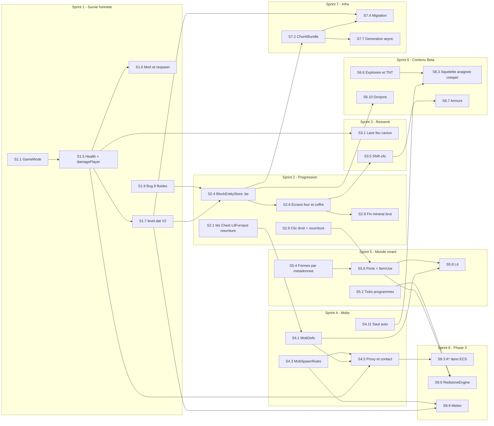

# Roadmap Gameplay — BetaCraft 1.7.3

| | |
|---|---|
| **Date** | 17 octobre 2026 |
| **Statut** | Proposé, à valider. Aucune tâche n'est commencée. |
| **Document parent** | [`docs/IMPROVEMENTS_ROADMAP.md`](IMPROVEMENTS_ROADMAP.md) (Phases 1 à 3, fiches techniques) |
| **Source du périmètre** | Synthèse critique « améliorations gameplay à faire avant la Phase 3 » : Tier A, B, C, ordre des sprints 1 à 8, réordonnancement de la Phase 3 |
| **Base de code** | branche `master`, copie de travail modifiée. Les numéros de ligne correspondent à cet état. |

> **Résumé**
> 1. Aujourd'hui, BetaCraft est un bac à sable créatif. Le moteur est solide : streaming, ECS, fluides, éclairage différentiel, minage avec outils, craft 2x2 et 3x3. En revanche, le joueur est immortel (`Player.cpp:179, :304`), les triches sont toujours actives et l'inventaire n'est pas sauvegardé.
> 2. Plusieurs modules testés tournent à vide : `gameplay::Health` et `Survival`, `DeathDrops`, `MobAISystem`, le corps à corps et le recul. Le joueur ne s'en sert pas.
> 3. La chaîne « arbre → établi → pioche → pierre » fonctionne. Tout ce qui suit est absent : four, coffre, nuit dangereuse, mort.
> 4. Stratégie : **le gameplay passe avant la Phase 3.** Les sprints 1 à 6 branchent les modules existants et ajoutent le contenu Beta. Le Sprint 7 avance les fichiers de région (P1.7) et le travail asynchrone. Le Sprint 8 garde seulement A\*, la redstone et la météo.
> 5. Le maillage glouton, le MDI, le Hi-Z et le LOD sont reportés. Ils ne démarrent que lorsqu'une mesure dans l'overlay F3 franchit un seuil défini.

---

## Table des matières

1. [Vue d'ensemble](#vue-densemble)
2. [Graphe des dépendances](#graphe-des-dépendances)
3. [Sprint 1 — Survie honnête](#sprint-1--survie-honnête)
4. [Sprint 2 — Progression des matériaux](#sprint-2--progression-des-matériaux)
5. [Sprint 3 — Ressenti des dégâts et ergonomie](#sprint-3--ressenti-des-dégâts-et-ergonomie)
6. [Sprint 4 — Premiers mobs](#sprint-4--premiers-mobs)
7. [Sprint 5 — Monde vivant](#sprint-5--monde-vivant)
8. [Sprint 6 — Contenu Beta](#sprint-6--contenu-beta)
9. [Sprint 7 — Infrastructure utile](#sprint-7--infrastructure-utile)
10. [Sprint 8 — Phase 3 recentrée](#sprint-8--phase-3-recentrée)
11. [Conventions transverses](#conventions-transverses)
12. [Phase 3 reportée et conditions de déclenchement](#phase-3-reportée-et-conditions-de-déclenchement)
13. [Backlog et idées hors plan](#backlog-et-idées-hors-plan)
14. [Suivi](#suivi)
15. [Annexe : corrections faites lors de la relecture](#annexe--corrections-faites-lors-de-la-relecture)

---

## Vue d'ensemble

Efforts : S ≤ 0,5 j, M = 1 à 3 j (compté 2 j), L > 3 j (compté 5 j). Ces estimations sont basses, en jours-développeur, avec les tests inclus.

| Sprint | Objectif | Items couverts | Effort estimé | Dépend de |
|---|---|---|---|---|
| **1 — Survie honnête** | On peut mourir, réapparaître et retrouver son inventaire après un redémarrage. | A1, A2, A3 ; bugs 1, 2, 3, 7, 8, 9, 12 | ≈ 11 j | — |
| **2 — Progression des matériaux** | Bois → pierre → fer fondu → diamant, sans triche. | A4, A5, A6 ; bugs 4 et 5 ; Tier C « unifier les identifiants d'objets » | ≈ 11,5 j | S1 (sauvegarde versionnée, santé, S1.9) |
| **3 — Ressenti des dégâts et ergonomie** | Le danger se voit et s'entend, et l'inventaire se manipule comme dans Beta. | A7, A8 ; bugs 6, 10, 11 | ≈ 7,5 j | S1, S2 (écrans de conteneur) |
| **4 — Premiers mobs** | La nuit devient dangereuse. | B1, première vague (cochon, mouton, zombie) | ≈ 10 j | S1 (`damagePlayer`), S2 (objets 319 et 320) |
| **5 — Monde vivant** | Le monde évolue seul et les blocs de survie arrivent. | B2, B3, B4 ; Tier C « journée de 20 min » | ≈ 20,5 j (18,5 j sans les escaliers) | S1, S2, S4 (moutons, hostiles) |
| **6 — Contenu Beta** | Le bestiaire est complet, avec explosions, armure, filons et donjons. | B1, seconde vague ; B5, B6, B7 (filons et donjons) | ≈ 20 j | S2, S4, S5 |
| **7 — Infrastructure utile** | Exploration sans saccade, plusieurs mondes, format de sauvegarde stable. | P1.7 (avancé) ; Tier C « génération et écriture asynchrones », « sélection de monde » | ≈ 23 j | S1 (`level.dat` V2), S2 (`.be`) |
| **8 — Phase 3 recentrée** | Mobs qui contournent les obstacles, redstone sur les portes, météo. | P2.2 (A\*), P2.4 (redstone), P4.5 (météo) | ≈ 24,5 j | S4, S5 |
| **Total** | | | **≈ 128 j-dev** | |

---

## Graphe des dépendances



---

## Sprint 1 — Survie honnête

*Objectif : on peut mourir, réapparaître, et retrouver son inventaire après un redémarrage.*

> Les règles de sauvegarde que ce sprint met en place (V2, versions, écriture atomique, quarantaine) sont dans [Conventions transverses §1](#1-versionnement-des-sauvegardes). Elles s'appliquent à tous les sprints suivants.

**Définition of Done**
- **Survie :** dans un nouveau monde, l'inventaire de départ est vide. F, T, la palette et le clic molette « 64 blocs » sont sans effet. En Créatif, tout se comporte comme aujourd'hui.
- **Dégâts :** une chute de 10 blocs retire 7 PV (3,5 cœurs). Rester sous l'eau tue par noyade, tomber dans le vide aussi. Les PV ne remontent jamais tout seuls.
- **Mort :** l'inventaire se répand au sol, l'écran « You died! » s'affiche, puis « Respawn » renvoie au point d'apparition avec 20 PV.
- **Redémarrage :** on quitte, on relance, et on retrouve tout à l'identique : inventaire (usure comprise), santé, emplacement sélectionné, mode et point d'apparition. Explorer sans rien modifier n'écrit plus aucun `.chk`.

**Tâches**

1. **S1.1 — `GameMode` porté par le joueur** (S)
   - **Fichiers :** `src/core/Config.hpp`, `src/physics/Player.{hpp,cpp}`, `src/main.cpp`.
   - **Changement :**
     - Dans `core/Config.hpp` : `enum class GameMode : uint8_t { Survival = 0, Creative = 1 };` et `std::optional<GameMode> parseGameMode(std::string_view)`. Ajouter `GameMode defaultGameMode{GameMode::Survival}` dans `EngineConfig`.
     - Dans `Player` : `void setGameMode(core::GameMode)` (le passage en Survie force `m_flying = false`), `core::GameMode gameMode() const` et `bool isCreative() const`.
     - `toggleFlyMode()` (`Player.hpp:92`) devient `bool toggleFlyMode()`. En Survie, il ne fait rien et renvoie `false`.
     - Option `--gamemode survival|creative` dans `main.cpp`. Elle ne s'applique qu'aux mondes neufs.
   - **Dépendances :** aucune.

2. **S1.2 — Inventaire de départ explicite** (S)
   - **Fichiers :** `src/physics/Player.cpp:8-37`, nouveaux `src/game/StarterKit.{hpp,cpp}` (à ajouter dans `BETACRAFT_CORE_SOURCES`).
   - **Changement :**
     - `Player()` démarre avec un inventaire vide.
     - `void applyStarterKit(physics::Player&, core::GameMode)` : en Créatif, la liste actuelle (`Player.cpp:9-36`) ; en Survie, rien, comme dans Beta.
     - L'eau et la lave ne sont donc plus jamais données en Survie (S6.4 n'a plus à le faire).
   - **Dépendances :** S1.1.

3. **S1.3 — Triches réservées au Créatif** (S)
   - **Fichiers :** `src/game/Application.cpp`, `src/ui/HudRenderer.{hpp,cpp}`, `src/physics/Player.{hpp,cpp}`.
   - **Changement :**
     - **Clic molette** (`Application.cpp:314-320`) : en Créatif, comportement actuel. En Survie, appeler le nouveau `bool Player::selectHotbarSlotHolding(gameplay::ItemId)`, qui sélectionne seulement un emplacement de barre déjà occupé par cet objet (« pick block » Beta).
     - **F et T** (`:372-385`) : seulement si `m_player.isCreative()`. Le prédicat unique est décrit dans les [conventions](#3-mode-de-jeu-et-feature-flags).
     - **Poussée du piston au clic droit** (`:490-512`) : Créatif uniquement.
     - **Palette :**
       - `HudDebugContext` gagne `bool creative` ;
       - la palette et son titre (`HudRenderer.cpp:379-385`) ne s'affichent qu'en Créatif ;
       - `hitTestInventory(..., int gridDim, bool withPalette = true)` : la valeur par défaut préserve `tests/phase2/crafting/test_hud_inventory_layout.cpp` ;
       - le cas `InventoryRegion::Palette` (`Application.cpp:452-454`) est protégé par le mode.
     - **Bandeau d'aide** (`HudRenderer.cpp:238-247`) : son texte dépend du mode. Les cœurs et les bulles sont masqués en Créatif.
   - **Dépendances :** S1.1, S1.2.

4. **S1.4 — Choix du mode sur l'écran titre** (S)
   - **Fichiers :** `src/ui/TitleScreen.{hpp,cpp}`, `src/game/Application.{hpp,cpp}`.
   - **Changement :**
     - Dans `TitleScreen` : `setNewWorld(bool)` ; un bouton `id 4` « Game Mode: Survival/Creative », visible seulement pour un monde neuf, qui alterne entre les deux modes ; l'accesseur `core::GameMode selectedMode() const`.
     - `Application` reçoit `bool m_isNewWorld`, positionné dans `initialize()` quand le chargement du `level.dat` renvoie `Missing`.
     - Au passage en `InGame` depuis le titre (`Application.cpp:191-194`), pour un monde neuf : `setGameMode`, puis `applyStarterKit`, puis sauvegarde immédiate du `level.dat`, puis `m_isNewWorld = false`.
     - Ce bouton est provisoire : S7.8 le remplace par l'écran de création de monde.
   - **Dépendances :** S1.1, S1.2, S1.7.

5. **S1.5 — Une seule santé pour le joueur, et un seul point d'entrée des dégâts** (M)
   - **Fichiers :** `src/physics/Player.{hpp,cpp}`, `src/game/GameSession.{hpp,cpp}`.
   - **Changement côté `Player` :**
     - Remplacer `m_health`, `m_airSeconds` et `m_regenTimer` (`Player.hpp:168-170`) par `gameplay::Health m_health{gameplay::makeHealth(20)}`, `gameplay::Breath m_breath` et `float m_pendingFall{0}`.
     - Supprimer le bloc d'air et de régénération (`Player.cpp:171-191`).
     - À l'atterrissage (`:296-311`), ne plus infliger de dégâts : `m_pendingFall = std::max(m_pendingFall, m_fallDistance)`. Le son passe désormais par l'événement de blessure (S3.3).
     - Nouvelle API : `gameplay::Health& health()`, `const gameplay::Health& health() const`, `gameplay::Breath& breath()`, `float takePendingFall() noexcept` (lit puis remet à zéro) et `bool isDead() const`.
     - `getHealth()`, `setHealth()` et `getAirRatio()` (`Player.hpp:110-112`) restent, réécrites au-dessus des nouveaux champs. `getAirRatio()` devient `clamp(breath.air, 0, 300) / 300`.
     - **Vide** (`Player.cpp:365-372`) : plus de téléportation en Survie. En Créatif, elle reste comme filet de sécurité.
   - **Point d'entrée unique des dégâts** (utilisé par S3, S4, S5, S6 et S8) :
     ```cpp
     // GameSession.hpp
     enum class DamageCause : uint8_t { Fall, Drown, Void, Lava, Fire, Cactus /* S4+: Mob, Projectile, Explosion, Suffocation, ajoutés à la fin */ };
     struct PlayerDamage { int32_t amount; DamageCause cause; std::optional<glm::vec3> sourcePos{}; bool bypassArmor{false}; };
     struct PlayerHurtEvent { int32_t amount; DamageCause cause; bool killed; };
     gameplay::HitResult damagePlayer(physics::Player&, const PlayerDamage&, GameTickEvents&);
     ```
     - `damagePlayer` ne fait rien en Créatif ou si le joueur est mort.
     - Sinon, il appelle `gameplay::applyDamage` (la fenêtre d'invulnérabilité s'applique), puis ajoute un `PlayerHurtEvent`, puis met `playerDied` à vrai si `HitResult::killed`.
     - Il est **interdit** d'écrire directement dans `Health::current`.
     - L'armure (S6.7) et le recul (S4.5) se brancheront ici.
   - **Changement côté `GameSession` :**
     - `GameTickEvents` (`GameSession.hpp:47`) gagne `std::vector<PlayerHurtEvent> playerHurt; bool playerDied{false};`.
     - Nouvelle fonction privée `void tickPlayerSurvival(world::World&, physics::Player&, GameTickEvents&)`, appelée **en premier** dans `GameSession::tick` (`GameSession.cpp:42`). Elle enchaîne :
       1. `fallDamage(player.takePendingFall())` (`Health.hpp:73`) ;
       2. `tickBreath(player.breath(), player.isHeadUnderWater())` (`Survival.hpp:24`) ;
       3. `outOfWorldDamage(pos.y)` (`Survival.hpp:31`, seuil −64) ;
       4. chaque dégât passe par `damagePlayer` ;
       5. `tickHealth` en dernier.
     - En Créatif, la chute en attente est vidée et l'air est remis au maximum.
   - **Dépendances :** S1.1.

6. **S1.6 — Mort, écran de mort, réapparition** (M)
   - **Fichiers :** `src/ui/ScreenState.hpp`, nouveaux `src/ui/DeathScreen.{hpp,cpp}` (à ajouter dans CMake), `src/game/GameSession.{hpp,cpp}`, `src/game/Application.{hpp,cpp}`, `src/world/World.{hpp,cpp}`.
   - **Changement :**
     - Ajouter `DeathScreen` **à la fin** de l'enum `ScreenState`. Les valeurs 0 à 4 ne bougent pas, voir la [convention sur les enums](#5-garder-les-suites-existantes-vertes).
     - `size_t GameSession::dropInventoryOnDeath(physics::Player&)` :
       - convertit les 36 emplacements avec `toItemStack` ;
       - appelle `gameplay::scatterInventoryOnDeath(span, player.getEyePosition(), m_rng.next())` (`DeathDrops.hpp:31`) ;
       - pour chaque `DroppedItem`, appelle `spawnItem(stack, position, velocity)` avec `pickupDelaySeconds = pickupDelayTicks * TICK_SECONDS` ;
       - vide l'inventaire.
     - `ui::DeathScreen` suit le modèle de `TitleScreen` : `render(...)` et `DeathChoice handleMouseClick(...)`, avec `DeathChoice { None, Respawn, TitleMenu }`.
     - **Dans `Application`, si `events.playerDied` :**
       1. `closeInventoryScreen()` si l'inventaire est ouvert. C'est obligatoire avant la dispersion, pour que la grille et l'objet porté par le curseur tombent aussi ;
       2. `dropInventoryOnDeath` ;
       3. `m_session.resetMining()` ;
       4. passage en `DeathScreen` et libération de la souris.
     - **`void Application::respawnPlayer()` :**
       1. `gameplay::respawn(health)` et air remis au maximum ;
       2. `m_world->updateChunksAround(spawn, 3, 64)` ;
       3. `setPosition(m_world->findStandableAbove(m_spawnPoint))` ;
       4. `resetInterpolationHistory()`, puis retour en `InGame` avec la souris capturée.
     - Nouveau `glm::vec3 World::findStandableAbove(glm::vec3)` : remonte jusqu'à trouver les pieds et la tête libres.
     - Le bouton « Title menu » réutilise la sauvegarde du menu pause.
     - `m_spawnPoint` vaut `findSafeSpawnPosition()` (`World.cpp:709`) dans un monde neuf, sinon la valeur lue dans `level.dat`.
   - **Dépendances :** S1.5, S1.7.

7. **S1.7 — `level.dat` V2 : sauvegarde complète du joueur** (M)
   - **Fichiers :** `src/world/WorldStorage.{hpp,cpp}`, `src/world/World.hpp` (l'enveloppe `loadLevelData`, `World.hpp:111-113`), nouveaux `src/game/PlayerPersistence.{hpp,cpp}` (à ajouter dans CMake), `src/game/Application.cpp`, `src/game/InventoryCrafting.{hpp,cpp}`.
   - **Structures :**
     ```cpp
     struct SavedStack { uint16_t id{0}; int32_t count{0}; int32_t damage{0}; };
     struct PlayerSaveData {
         core::GameMode mode{core::GameMode::Survival};
         int32_t health{20}, air{300}, selectedSlot{0}, fireTicks{0};
         float fallDistance{0.0f};
         std::array<SavedStack, 36> inventory{};
     };
     // WorldLevelData (WorldStorage.hpp:15-21) += uint32_t itemsScheme{1}; std::optional<glm::vec3> spawnPos;
     //                                           std::optional<PlayerSaveData> player;
     enum class LevelLoadStatus : uint8_t { Missing, Ok, LegacyV1, Corrupt, TooNew };
     [[nodiscard]] std::string encodeLevelData(const WorldLevelData&);
     [[nodiscard]] LevelLoadStatus decodeLevelData(std::string_view, WorldLevelData& out);
     ```
   - **Chargement et écriture :**
     - `WorldStorage::loadLevelData` et `World::loadLevelData` renvoient `LevelLoadStatus`. Une surcharge `bool` est conservée pour les tests existants.
     - L'écriture est atomique ([§1](#1-versionnement-des-sauvegardes), règle 4).
     - `level.dat.v1.bak` est écrit une seule fois, à la migration depuis V1.
   - **Pont avec le jeu :**
     - `world::PlayerSaveData capturePlayer(const physics::Player&, std::span<const physics::InventorySlot> pending)`. Le paramètre `pending` contient la grille et l'objet porté par le curseur, qui sont remis dans une **copie** du joueur via `insertStack` (`Player.hpp:134`). Une sauvegarde faite avec l'inventaire ouvert ne perd donc rien.
     - `void restorePlayer(physics::Player&, const world::PlayerSaveData&)` borne les valeurs : nombre entre 1 et `maxStackSize`, PV entre 0 et 20. Un identifiant inconnu vide l'emplacement et produit un avertissement.
     - `std::vector<physics::InventorySlot> InventoryCrafting::pendingStacks() const`.
   - **Côté `Application` :**
     - Les 3 copies de `WorldLevelData{...}` (`Application.cpp:274-281`, `388-395`, `852-859`) sont remplacées par `world::WorldLevelData makeLevelData() const`.
     - `initialize()` (`:111-125`) selon le statut :
       - `Ok` : `restorePlayer` ;
       - `LegacyV1` : mode Créatif, kit Créatif, point d'apparition calculé par `findSafeSpawnPosition()` ;
       - `TooNew` ou `Corrupt` : `m_saveDisabled = true`, sans régénérer de monde.
     - Quarantaine des `.chk` illisibles dans `WorldStorage::loadChunk` ([§1](#1-versionnement-des-sauvegardes), règle 5).
   - **Dépendances :** S1.1, S1.5.

8. **S1.8 — Bug n°9 : le balancement de caméra fausse la visée** (S)
   - **Fichiers :** `src/physics/Player.{hpp,cpp}`, `src/render/WorldRenderer.cpp`.
   - **Changement :**
     - `getInterpolatedEyePosition(alpha)` ne contient plus le balancement (`Player.cpp:83-86`). Elle sert au jeu : lancer de rayon (`Application.cpp:639`), corps à corps et objets de mort (`GameSession.cpp:104, 126`, via `getEyePosition()`), acoustique (`Application.cpp:606`).
     - Nouvelle `glm::vec3 getCameraEyePosition(float alpha) const`, qui ajoute le balancement. `getInterpolatedViewMatrix` (`Player.cpp:101-105`) l'utilise.
     - `WorldRenderer.cpp:438` et `:495`, qui appellent aujourd'hui `player.getEyePosition()`, passent à `player.getCameraEyePosition(player.getRenderAlpha())`, pour rester cohérents avec la matrice de vue de `:524`.
   - **Dépendances :** aucune.

9. **S1.9 — Bug n°8 : les fluides marquent des chunks comme modifiés** (M)
   - **Fichiers :** `src/world/Chunk.{hpp,cpp}`, `src/world/World.{hpp,cpp}`.
   - **Changement côté `Chunk` :** un drapeau persistant `bool m_playerTouched`, avec `markPlayerTouched()` et `isPlayerTouched()`. Il passe à `true` après un `deserializeRLE` réussi (un chunk sur disque a forcément été modifié) et à chaque modification publique.
   - **Changement côté `World` :**
     - `applyBlockEdit` et `applyMetadataEdit` (`World.hpp:121-122`) gagnent un paramètre `EditOrigin origin`, avec `enum class EditOrigin : uint8_t { Player, Simulation }`.
     - `World::FluidAccess::setBlock` et `setFluid` (`World.cpp:44-60`) passent `Simulation`.
     - Avec `Simulation`, `chunk->setBlock(..., markModified)` (aujourd'hui `true` en dur, `World.cpp:341`) et `setMetadata` reçoivent `markModified = persistSimulationEdits(coord)`, c'est-à-dire « ce chunk ou l'un de ses 8 voisins `isPlayerTouched()` ».
     - Les fluides issus de la génération sont simulés à nouveau au rechargement par `scheduleUnsettledFluids` (`World.cpp:168`).
     - `setBlock`, `setMetadata`, `setBlockWithMetadata` et `triggerPistonPush` restent en `Player`.
     - Le test existant `FluidLevelChangesDoNotQueueRemeshes` (`test_p2_fixes_streaming.cpp:123`) reste vert, puisqu'il passe par l'origine `Player`.
   - **Dépendances :** aucune.

10. **S1.10 — Bug n°12 : le test de performance acoustique fait échouer la CI** (S)
    - **Fichiers :** `tests/phase2/acoustics/test_pipeline.cpp` (test `AcousticPipeline.DdaRayMeetsTheSpecBudgetInOptimisedBuilds`), `CMakeLists.txt` (à côté de la boucle `add_test(NAME Phase2_${key} ...)`).
    - **Changement :**
      - `GTEST_SKIP()` sauf si `std::getenv("BETACRAFT_PERF_TESTS")` est défini. Le seuil de 0,5 µs ne change pas.
      - Ajouter `add_test(NAME Phase2_acoustics_perf COMMAND betacraft_p2_acoustics_tests --gtest_filter=AcousticPipeline.*Budget*)` et `set_tests_properties(Phase2_acoustics_perf PROPERTIES LABELS benchmark ENVIRONMENT BETACRAFT_PERF_TESTS=1)`.
      - La CI lance `ctest -LE benchmark` ([§4](#4-règles-de-ci)).
    - **Dépendances :** aucune.

**Tests**
- **`tests/unit/test_world_storage.cpp`** : `LevelDataV2RoundTripsPlayerSpawnAndMode`, `LegacyV1LevelLoadsAsLegacy` (texte V1 littéral), `UnknownKeysAreIgnored`, `MissingKeysKeepDefaults`, `TooNewVersionIsRefused`, `MalformedInventoryLineIsSkipped`, `SaveWritesBackupAndIsAtomic` (`level.dat_old` présent, aucun `.tmp` restant), `UnreadableChunkIsQuarantined`.
- **`tests/unit/test_physics.cpp`** : `DefaultPlayerHasEmptyInventory`, `SurvivalCannotToggleFly`, `LandingRecordsPendingFallWithoutDamage`. `HealthBounds` est adapté (même API).
- **`tests/unit/test_physics_fixed_step.cpp`** : `BobbingMovesCameraButNotGameplayEye`. On marche 30 pas, puis on vérifie que `getInterpolatedEyePosition(a).y == pos.y + eyeH`, alors que `getCameraEyePosition(a).y` en diffère.
- **Nouveau `tests/integration/phase2/test_s1_survival.cpp`** (fixture `P2GameplaySupport.hpp`) :
  - `TenBlockFallCostsSevenHalfHearts`, `ThreeBlockFallIsSafe`, `CreativeIgnoresFallAndDrowning` ;
  - `DrowningStartsAfter300TicksThenTwoEvery20`, `VoidKillsInSurvival`, `NoNaturalRegeneration` (1 200 ticks) ;
  - `DamagePlayerRespectsInvulnerabilityWindow` ;
  - `DeathFiresOnceAndScattersEveryStack` (total d'objets conservé, délai de ramassage de 40 ticks) ;
  - `RespawnRestoresHealthAirAndSpawn`.
- **Nouveau `tests/integration/phase2/test_s1_fluid_persistence.cpp`** :
  - `GeneratedFluidSettlingMarksNothingModified` : graine de `test_p2_fluids_world.cpp`, `tick()` fait des mises à jour mais aucun chunk n'est `isModified()` ;
  - `PlayerWaterFlowingAcrossASeamIsPersisted` : eau posée en `x = 15`, le chunk voisin est modifié, puis déchargé, rechargé et comparé.
- **`tests/integration/test_integration_persistence.cpp`** : `PlayerInventoryHealthSpawnSurviveRestart` (`capturePlayer` et `restorePlayer` autour de deux `World` sur le même dossier).
- **`tests/phase2/crafting/test_hud_inventory_layout.cpp`** : `PaletteIsNotHitWithoutCreative`.
- **`tests/e2e/test_e2e_application.cpp`** : `SurvivalWorldSavesInventoryOnShutdown`. On lance `runFixedFrames`, on donne un objet, on appelle `shutdown`, on crée une nouvelle `Application` sur le même `TempDir`, puis on compare l'inventaire.

**Checklist de playtest**
- [ ] Nouveau monde en Survie : hotbar vide ; F, T et le clic molette ne font rien ; pas de palette dans l'inventaire (E).
- [ ] Chute d'une falaise d'environ 10 blocs : 3,5 cœurs perdus, aucune régénération en 2 minutes.
- [ ] Noyade jusqu'à la mort, écran de mort, puis « Respawn » : les objets sont au sol à l'endroit de la mort et ramassables après 2 s.
- [ ] Mourir avec l'établi ouvert et des objets dans la grille : ils sont aussi dispersés.
- [ ] Viser un bloc en marchant : la surbrillance ne saute plus.
- [ ] Quitter avec l'inventaire ouvert, relancer : rien n'est perdu.
- [ ] Ancien monde V1 : il s'ouvre en Créatif avec l'ancien kit, et `level.dat.v1.bak` est présent.
- [ ] Explorer 5 minutes sans rien casser : aucun nouveau `.chk` dans `saves/world1/chunks`.

**Risques et points d'attention**
- **Tests qui supposent l'ancien comportement :**
  - `tests/unit/test_adversarial_tier5.cpp:427` (`VoidFallRecoveryAndCeilingBoundary`) attend la téléportation : passer le joueur en Créatif dans ce test.
  - `tests/test_main.cpp:138-145` compte déjà les planches en delta et reste valide. Il faut néanmoins vérifier qu'il ne dépend pas d'autres objets du kit.
- **Formule de chute :** on passe de `floor(d-3)` avec un seuil de 3,5 à `fallDamage` (`ceil(d-3)`, seuil de 3, comme Beta). Une chute de 3,2 blocs coûte désormais 1 PV.
- **Tick de jeu et physique :** la chute en attente est lue par le tick de jeu (20 TPS) et non par la physique (60 Hz). Deux atterrissages entre deux ticks donnent le maximum des deux, ce qui est acceptable.
- **Monde figé à la mort :** `update()` ne fait rien hors `InGame` (`Application.cpp:599`), donc le monde est figé pendant l'écran de mort. C'est un écart volontaire par rapport à Beta.
- **Sauvegardes :** un V1 ne contient pas d'inventaire, d'où le passage en Créatif avec l'ancien kit. Un binaire antérieur au Sprint 1 ne lit pas le V2, d'où le `level.dat.v1.bak`.
- **Heuristique S1.9 :** de l'eau du joueur qui s'écoule à plus d'un chunk de toute modification n'est pas sauvegardée, mais elle est simulée à nouveau au rechargement.

**Hors périmètre**
- Lave, cactus, feu, retours visuels et sonores (Sprint 3).
- Mode Paisible et difficulté.
- Casse instantanée et pose sans consommation en Créatif.
- Persistance des entités ECS : les objets au sol sont perdus au redémarrage.
- Monde actif pendant l'écran de mort.
- Écran de sélection de monde (S7.8).

---

## Sprint 2 — Progression des matériaux

*Objectif : bois → pierre → fer fondu → diamant, sans triche.*

**Définition of Done**
- **Four :** il se pose, s'ouvre au clic droit et fond le minerai de fer et d'or, le sable, la pierre taillée et les bûches. Il s'allume (lumière 13) quand il brûle, et l'avancement est visible (flèche et flamme).
- **Coffre :** il se fabrique, se pose et contient 27 emplacements. Son contenu survit au redémarrage et tombe au sol quand on le casse.
- **Recettes :** une grille 3x3 de minerai de fer ne donne plus d'outil. Seul un lingot fonctionne.
- **Nourriture :** une pomme (tirée des feuilles) se mange au clic droit, même en visant le ciel, et rend 2 cœurs.

**Tâches**

1. **S2.1 — Identifiants : blocs, objets, apparence** (S)
   - **Fichiers :** `src/world/Block.{hpp,cpp}`, `src/crafting/ItemIds.hpp` (`kDefinedBlockIds`, `:39-52`), `src/gameplay/ItemIds.hpp`, `src/render/ItemAppearance.cpp`, `src/render/TextureAtlas.cpp`.
   - **Changement :**
     - Ajouter `BlockId::Chest = 54` et `BlockId::LitFurnace = 62` (identifiants libres, inférieurs à `Count = 106`) dans l'enum et dans `kDefinedBlockIds`.
     - Retirer l'exception sur le coffre (`crafting/ItemIds.hpp:73-75`) et mettre à jour le commentaire de `gameplay/ItemIds.hpp`.
     - Ajouter `items::Apple = 260`, `Bowl = 281`, `MushroomStew = 282`, `Bread = 297`, `RawPorkchop = 319`, `CookedPorkchop = 320`, `GoldenApple = 322`, avec nom et couleur dans `ItemAppearance`.
     - Tuiles d'atlas « coffre : dessus, côté, face » et « four allumé : face », sur des index libres à relever d'abord dans `TextureAtlas.cpp`.
   - **Dépendances :** aucune.

2. **S2.2 — Recettes de cuisson et combustibles** (S)
   - **Fichiers :** nouveaux `src/crafting/SmeltingRecipes.{hpp,cpp}` (compilés automatiquement par le glob).
   - **API :**
     ```cpp
     inline constexpr int32_t kSmeltTicks = 200;
     struct SmeltingRecipe { ItemId input; SlotStack output; };
     class SmeltingBook {
     public:
         [[nodiscard]] static const SmeltingBook& beta();
         [[nodiscard]] std::optional<SlotStack> result(ItemId input) const noexcept; // canonicalize(input)
     };
     [[nodiscard]] int32_t fuelBurnTicks(ItemId id) noexcept; // 0 = pas un combustible
     ```
   - **Recettes :**
     - minerai de fer → lingot de fer ; minerai d'or → lingot d'or ; minerai de diamant → diamant ;
     - sable → verre ; pierre taillée → pierre ;
     - bûches (chêne, bouleau, pin) → `items::Coal`, sans distinguer le charbon de bois ;
     - porc cru → porc cuit, enregistré dès maintenant.
   - **Combustibles :**
     - charbon : 1 600 ticks ;
     - planches, bûches, établi, bibliothèque, coffre : 300 ;
     - bâton, pousse : 100 ;
     - seau de lave : 20 000 (utilisable seulement à partir de S6.4).
   - **Dépendances :** S2.1.

3. **S2.3 — Données des entités de bloc et logique du four** (M)
   - **Fichiers :** nouveau `src/world/BlockEntity.hpp`, nouveaux `src/crafting/Furnace.{hpp,cpp}`.
   - **Types :**
     ```cpp
     // world/BlockEntity.hpp : données neutres, sans dépendance vers crafting
     struct StoredStack { uint16_t id{0}; uint8_t count{0}; uint16_t damage{0}; };
     struct FurnaceData { StoredStack input, fuel, output; int16_t burnTicks{0}, burnTicksTotal{0}, cookTicks{0}; };
     struct ChestData { std::array<StoredStack, 27> slots{}; };
     using BlockEntity = std::variant<FurnaceData, ChestData>;
     // crafting/Furnace.hpp : règles de TileEntityFurnace.updateEntity (Beta)
     struct FurnaceTickResult { bool changed{false}; bool litChanged{false}; bool smelted{false}; };
     FurnaceTickResult tickFurnace(world::FurnaceData&, const SmeltingBook&) noexcept;
     [[nodiscard]] float cookProgress(const world::FurnaceData&) noexcept; // 0..1
     [[nodiscard]] float burnProgress(const world::FurnaceData&) noexcept;
     ```
   - **Règles :**
     - quand le four brûle, `burnTicks` diminue ;
     - à 0, il ne consomme un combustible que si `canSmelt` est vrai : le résultat est connu, et la sortie est vide ou contient le même objet avec de la place ;
     - `cookTicks` augmente tant que le four brûle et que `canSmelt` est vrai ; à 200, l'objet est fondu ;
     - sinon, `cookTicks` revient à 0.
   - **Dépendances :** S2.2.

4. **S2.4 — `BlockEntityStore` dans `World` et persistance `.be`** (M)
   - **Fichiers :** nouveaux `src/world/BlockEntityStore.{hpp,cpp}` (à ajouter dans CMake), `src/world/World.{hpp,cpp}`, `src/world/WorldStorage.{hpp,cpp}`.
   - **API :**
     ```cpp
     class BlockEntityStore {
     public:
         [[nodiscard]] BlockEntity* find(core::BlockPos) noexcept;
         BlockEntity& getOrCreate(core::BlockPos, BlockId kind);   // Furnace/LitFurnace → FurnaceData, Chest → ChestData
         std::optional<BlockEntity> take(core::BlockPos);
         [[nodiscard]] std::vector<std::pair<core::BlockPos, BlockEntity>> extractChunk(core::ChunkCoord);
         void insertChunk(core::ChunkCoord, std::vector<std::pair<core::BlockPos, BlockEntity>>);
         template <class Fn> void forEach(Fn&&);
     private:
         std::unordered_map<core::ChunkCoord, std::unordered_map<uint16_t /*lx|lz<<4|y<<8*/, BlockEntity>> m_byChunk;
     };
     std::vector<uint8_t> encodeBlockEntities(std::span<const std::pair<core::BlockPos, BlockEntity>>);
     std::optional<std::vector<std::pair<core::BlockPos, BlockEntity>>> decodeBlockEntities(core::ChunkCoord, std::span<const uint8_t>);
     ```
   - **Format `.be` :**
     - en-tête : `"BCBE"`, version `u8` (`kBlockEntityFormatVersion = 1`), nombre d'entrées `u16` ;
     - chaque entrée : `u8 lx`, `u8 y`, `u8 lz`, `u8 kind` (1 = four, 2 = coffre), puis les emplacements codés `u16 id`, `u8 count`, `u16 damage`.
   - **Ajouts dans `World` :**
     - `BlockEntityStore& blockEntities()` ;
     - `void markBlockEntityChanged(core::BlockPos)`, qui appelle `chunk->setModified(true)` et `markPlayerTouched()` ;
     - `std::vector<RemovedBlockEntity> takeRemovedBlockEntities()`, sur le modèle de `takeUnsupportedBreaks` (`World.cpp:406`).
   - **Point de raccordement unique dans `applyBlockEdit` (`World.cpp:321`) :**
     - si l'ancien bloc portait une entité et que le nouveau n'est pas compatible, l'entité part dans `m_removedBlockEntities` ;
     - four et four allumé sont compatibles entre eux ;
     - le minage, les fluides et les futures explosions sont ainsi couverts d'un coup.
   - `triggerPistonPush` (`World.cpp:470`) refuse une ligne qui contient une entité de bloc, comme Beta.
   - **Disque :**
     - `persistChunk` (`World.cpp:211`) écrit `.dec`, puis `.be` (le fichier est supprimé s'il n'y a plus d'entités), puis `.chk` ;
     - `ensureChunkLoaded` (`:139`) relit le `.be` si le chunk vient du disque, et ignore avec un avertissement toute entrée dont le bloc ne correspond pas ;
     - au déchargement (`:262-271`), `extractChunk`.
   - **Dépendances :** S2.3, S1.9 (`markPlayerTouched`), S1.7 (constantes de version).

5. **S2.5 — Le four tourne** (S)
   - **Fichiers :** `src/world/Block.cpp` (définition de `LitFurnace` : `lightEmission = 13`, `dropId = Furnace`), `src/game/GameSession.{hpp,cpp}`.
   - **Changement :**
     - `void GameSession::tickBlockEntities(world::World&)` est appelée dans `tick()` après `handleAttack`. Pour chaque four, elle appelle `crafting::tickFurnace`, puis :
       - si `litChanged`, `world.setBlock(pos, burning ? LitFurnace : Furnace)`. L'entité est conservée grâce à la règle de compatibilité ;
       - si `changed`, `markBlockEntityChanged`.
     - `GameSession::tick` lit aussi `takeRemovedBlockEntities()` et appelle `spawnBlockDrop` pour chaque emplacement non vide.
   - **Dépendances :** S2.4.

6. **S2.6 — Écrans du four et du coffre** (M)
   - **Fichiers :** `src/game/InventoryCrafting.{hpp,cpp}`, `src/ui/HudRenderer.{hpp,cpp}`, `src/game/Application.{hpp,cpp}`.
   - **Côté `InventoryCrafting` :**
     - `enum class ScreenKind : uint8_t { Inventory2x2, Workbench3x3, Furnace, Chest }` ;
     - `openContainer(ScreenKind, core::BlockPos, physics::Player&)` et `std::optional<core::BlockPos> containerPos() const` ;
     - `bool clickContainerSlot(world::World&, size_t index, SlotButton)` : la règle de clic est factorisée avec `clickStack` ; la sortie du four est en prise seule (`SlotFurnace` Beta) ; chaque changement appelle `markBlockEntityChanged` ; l'écran se ferme si l'entité a disparu.
   - **Côté `HudRenderer` :**
     - `CraftingScreenView` (`HudRenderer.hpp:23`) gagne `ScreenKind kind`, `std::array<physics::InventorySlot, 27> container`, `float cookProgress` et `float burnProgress` ;
     - nouvelle valeur `InventoryRegion::Container`, ajoutée à la fin de l'enum (`:30`) ;
     - mise en page dans **la zone de la palette** (`rightX, py + 36`), où 9 colonnes de `kSlot = 38` tiennent exactement : coffre en 9x3, four sur le modèle Beta (entrée, flamme, combustible, flèche, sortie). La palette est masquée quand un conteneur est ouvert ;
     - `inventorySlotRect` et `hitTestInventory` reçoivent une surcharge `struct InventoryLayoutKey { int gridDim; ScreenKind kind; bool palette; }`, vers laquelle l'ancienne signature délègue.
   - **Côté `Application` :**
     - le clic droit ouvre l'écran sur `Furnace`, `LitFurnace` ou `Chest` si le joueur n'est pas accroupi (étape 2 de l'[ordre du clic droit](#2-ordre-du-clic-droit-et-dégâts)) ;
     - `gameTick` ferme l'écran au-delà de 8 blocs (`canInteractWith` Beta) ou si le chunk est déchargé.
   - **Dépendances :** S2.4.

7. **S2.7 — Le coffre comme bloc** (S)
   - **Fichiers :** `src/world/Block.cpp`.
   - **Changement :**
     - `BlockDef` du coffre : solide, opaque, `hardness = 2.5f`, son `Wood`, forme `Cube` (cube plein dans Beta 1.7.3), `dropId = Chest`, tuiles avant, dessus, dessous et côté.
     - `isPlaceableBlock(54)` devient vrai automatiquement grâce à S2.1.
   - **Dépendances :** S2.1, S2.4.

8. **S2.8 — Fin des recettes au minerai brut** (S)
   - **Fichiers :** `src/game/InventoryCrafting.cpp:24`.
   - **Changement :**
     - Le constructeur par défaut appelle `crafting::makeBetaRecipeBook(crafting::BetaRecipeOptions::vanilla())`, ce qui retire les variantes au minerai, les 6 dalles et la bibliothèque à la canne à sucre.
     - La valeur par défaut `acceptLegacyOres = true` (`BetaRecipes.hpp:16`) **ne change pas**, pour que `test_beta_recipes.cpp` (compatibilité avec les anciennes recettes) reste vert.
   - **Dépendances :** S2.5, S2.6. Sans four jouable, le fer deviendrait impossible à obtenir.

9. **S2.9 — Nourriture et refonte du clic droit** (S/M)
   - **Fichiers :** nouveaux `src/gameplay/Food.{hpp,cpp}` (compilés par le glob), `src/game/GameSession.{hpp,cpp}`, `src/game/Application.cpp:476-528`, `src/gameplay/Harvesting.cpp` (`dropRule`, `:79`).
   - **Valeurs de soin :** `struct FoodInfo { int32_t heal; gameplay::ItemId leftover{kNoItem}; }; std::optional<FoodInfo> foodInfo(ItemId)` avec les valeurs Beta :
     - pomme 4, pain 5, porc cru 3, porc cuit 8 ;
     - pomme dorée 20 ;
     - soupe 10, qui laisse un bol.
   - **`std::optional<int32_t> GameSession::useHeldItem(physics::Player&)`** : instantané, possible même avec la santé pleine, comme Beta, via `gameplay::heal` (`Health.hpp:62`). Un joueur mort ne mange pas.
   - **Refonte de `handleRightClickAction` :** il suit l'[ordre canonique du clic droit](#2-ordre-du-clic-droit-et-dégâts), et le `return` anticipé quand rien n'est visé (`:477`) disparaît. Ce point d'entrée est réutilisé par S5.6, S6.3 et S6.4.
   - **Feuilles :**
     - nouvelle `std::optional<DropRule> bonusDropRule(BlockId)` : pomme avec une chance sur 200 ;
     - `breakBlockWith` lance les deux tirages.
     - Écart probable par rapport à Beta 1.7.3, assumé : il n'y a pas d'autre source de nourriture avant les mobs.
   - **Dépendances :** S1.5, S2.1.

10. **S2.10 — Unification des identifiants d'objets (Tier C, « T.1 »)** (M)
    - **Fichiers :** `src/gameplay/ItemIds.hpp` (`canonicalize`, `kAliases`), `src/game/StarterKit.cpp` (S1.2), `src/ui/CreativePalette.hpp`, `src/crafting/BetaRecipes.cpp`, `src/game/PlayerPersistence.cpp`.
    - **Changement :**
      - Toute nouvelle production d'objet utilise `gameplay::items::*` en numérotation Beta (256 et plus). Plus aucun objet ne s'ajoute dans `BlockId` au-delà de 100.
      - La forme canonique devient le numéro Beta. Les anciens identifiants 100 à 105 restent lisibles, mais uniquement au **chargement** (inventaire, coffre), avec `items_scheme 2` dans `level.dat` ([§1](#1-versionnement-des-sauvegardes), règle 6).
      - Ajouter un `static_assert` qui garantit qu'aucun `BlockId` posable ne dépasse 255.
      - `ui::CraftingSystem`, qui n'est pas utilisé en jeu, n'est pas migré.
    - **Ordonnancement :** la tâche peut glisser au Sprint 3 si le Sprint 2 déborde. Elle est **obligatoire avant S4.1** (nouveaux objets lâchés).
    - **Dépendances :** S1.7.

**Tests**
- **Nouveau `tests/phase2/crafting/test_smelting.cpp`** : `EveryBetaRecipeSmelts`, `UnknownInputHasNoResult`, `FuelTableMatchesBeta`, `VanillaCoalAliasBurns1600` (identifiant 263 → `canonicalize`).
- **Nouveau `tests/phase2/crafting/test_furnace.cpp`** :
  - `OneCoalSmeltsEightOres` (1 600 ticks) ;
  - `CookTakesExactly200Ticks` ;
  - `NoFuelConsumedWithoutSmeltableInput` ;
  - `FullOrMismatchedOutputStallsAndResetsCook` ;
  - `LitFlagTogglesOnFirstAndLastBurnTick` ;
  - `RemovingInputMidCookResetsProgressButKeepsBurning`.
- **`tests/unit/test_world_storage.cpp`** : `BlockEntityCodecRoundTrip`, `BlockEntityCodecRejectsTruncatedAndBadMagic`, `BlockEntityV1GoldenBytesDecode`.
- **Nouveau `tests/integration/phase2/test_s2_block_entities.cpp`** :
  - `FurnaceProgressSurvivesUnloadReload` ;
  - `ChestContentsSurviveSaveModifiedChunks` ;
  - `BreakingAChestDropsAllStacks` ;
  - `FurnaceLitSwapKeepsInventory` (**bloquant**) ;
  - `PistonRefusesToPushAChest` ;
  - `CorruptBeFileStillLoadsTheChunk` ;
  - `EntityWithoutMatchingBlockIsDiscarded` ;
  - `NoBeFileForOldSaves`.
- **`tests/phase2/crafting/test_inventory_crafting.cpp`** : `FurnaceOutputIsTakeOnly`, `ChestSlotsMergeAndSwapLikeInventory`, `ContainerClickAfterBlockRemovedClosesScreen`.
- **`tests/phase2/crafting/test_beta_recipes.cpp`** : `GameBookRejectsRawOreTools`.
- **`tests/phase2/crafting/test_item_ids.cpp`** : `ChestAndLitFurnaceArePlaceable`, `LitFurnaceDropsFurnace`.
- **`tests/phase2/combat/test_item_ids.cpp`** : `NoNewLegacyIds`, `LoadFoldsLegacyIds`. `test_item_bridge.cpp` reste vert.
- **`tests/phase2/crafting/test_hud_inventory_layout.cpp`** : `FurnaceAndChestSlotsMapBackAndDoNotOverlap`.
- **Nouveau `tests/phase2/combat/test_food.cpp`** : `BetaHealValues`, `StewLeavesABowl`, `EatingAtFullHealthStillConsumes`, `DeadCannotEat`.
- **Nouveau `tests/integration/phase2/test_s2_progression.cpp`** : un scénario scripté en Survie, de la bûche jusqu'à la pioche en fer, qui se termine par l'obtention d'un diamant.

**Checklist de playtest**
- [ ] Four avec 8 minerais de fer et 1 charbon : il s'allume et éclaire, la flèche avance, on récupère 8 lingots, puis il s'éteint.
- [ ] Quitter en pleine cuisson, relancer : la progression et le combustible sont intacts.
- [ ] Coffre avec 27 piles, quitter, relancer : tout est là. Le casser : tout tombe.
- [ ] Une grille de minerai de fer ne donne aucune pioche ; des lingots, si.
- [ ] Obtenir une pomme dans des feuilles, la manger en visant le ciel avec 10 PV : on passe à 14 PV.
- [ ] Piston (Créatif) contre un coffre : rien ne bouge.

**Risques et points d'attention**
- **Duplication ou perte d'objets** lors du passage four ↔ four allumé, qui passe par `applyBlockEdit`. La règle de compatibilité est indispensable.
- **Sauvegardes :**
  - les anciennes sauvegardes n'ont pas de `.be`, ce qui est sans risque ;
  - les blocs 54 et 62 sont nouveaux, il n'y a donc pas de migration ;
  - le retour à un binaire plus ancien n'est pas supporté (règle 7) ;
  - le passage à `items_scheme 2` (S2.10) est testé avec un `level.dat` V2 et `items_scheme 1` figé.
- **`ui::CraftingSystem`** (encore utilisé par `test_ui.cpp`, `test_main.cpp` et `test_integration_mining_crafting.cpp`) garde ses recettes au minerai. Il n'est pas utilisé en jeu.
- **Mondes V1 en Créatif :** les 8 fours de l'ancien kit (`Player.cpp:23`) fonctionnent désormais.

**Hors périmètre**
- Double coffre.
- Orientation de la face avant (la métadonnée de direction n'est pas lue par `ChunkMesher`).
- Seaux (S6.4).
- Pain, porc et soupe réellement obtenables (S5.7, S4.1).
- Pomme dorée (le bloc d'or 41 n'existe pas).
- Brique d'argile, colorant de cactus.
- Shift-clic (S3.5).
- Coffres de donjon (S6.10).

---

## Sprint 3 — Ressenti des dégâts et ergonomie

*Objectif : le danger se voit, s'entend, et l'inventaire se manipule comme dans Beta.*

**Définition of Done**
- **Lave et cactus :** la lave retire 2 cœurs, puis le joueur brûle et perd 1 PV par seconde jusqu'à plonger dans l'eau. Le cactus retire 1 PV par contact.
- **Retour des blessures :** chaque blessure produit un flash rouge, une inclinaison de la caméra et un son. Sous 2 cœurs, les cœurs tremblent. Une chute lourde joue `FallBig`.
- **Inventaire :** Q jette un objet, Ctrl+Q toute la pile. Le shift-clic déplace les piles, et le nom de l'objet s'affiche au survol.
- **Options :** GUI Scale (Auto, 1x à 4x) change réellement la taille du HUD. La sensibilité de la souris se règle et persiste.

**Tâches**

1. **S3.1 — Dégâts de l'environnement : lave, feu, cactus** (S)
   - **Fichiers :** `src/physics/Player.{hpp,cpp}`, `src/gameplay/Survival.{hpp,cpp}`, `src/game/GameSession.cpp`, `src/game/PlayerPersistence.cpp`.
   - **Côté `Player` (calculé dans `fixedUpdate`) :**
     - `bool m_inLava` : `isLavaBlock(feetLow || feetMid)`, à côté de `Player.cpp:162-166` ;
     - `bool m_touchingCactus` : une cellule `Cactus` chevauche l'AABB rétrécie de 0,001 (`onEntityCollidedWithBlock` Beta) ;
     - accesseurs `isInLava()` et `isTouchingCactus()`.
   - **Côté gameplay :**
     - `struct Burning { int32_t fireTicks{0}; }` ;
     - `int32_t tickFire(Burning&, bool inLava, bool inWater) noexcept` : la lave remet le compteur à 600, on perd 1 PV quand `fireTicks % 20 == 0`, l'eau remet le compteur à 0 ;
     - constantes `kLavaDamage = 4` et `kCactusDamage = 1`.
   - `tickPlayerSurvival` ajoute les causes `Lava`, `Fire` et `Cactus`, toutes via `damagePlayer` (S1.5).
   - Nouvelle clé `player.fire` dans `level.dat`, sans changement de version (règle 3).
   - **Dépendances :** S1.5, S1.7.

2. **S3.2 — Retour visuel des blessures** (S/M)
   - **Fichiers :** `src/ui/HudRenderer.{hpp,cpp}`, `src/physics/Player.{hpp,cpp}`, `src/game/Application.cpp`, `src/game/GameSession.cpp`.
   - **Champs ajoutés à `HudDebugContext` :**
     - `float hurtFlash` (`gameplay::hurtFlashIntensity`, `Health.hpp:67`) ;
     - `bool heartsBlink` (`(ticks / 3) % 2` pendant l'invulnérabilité) ;
     - `bool lowHealth` (PV ≤ 4) ;
     - `bool burning` ;
     - `uint32_t jitterSeed`.
   - **Dans le dessin des cœurs (`HudRenderer.cpp:301-309`) :**
     - les cœurs tremblent de 1 à 2 px sous 4 PV et clignotent en blanc pendant l'invulnérabilité ;
     - voile rouge d'opacité `0.25 * hurtFlash` ;
     - voile orange quand le joueur brûle.
   - **Caméra :**
     - `int32_t m_hurtTime` (10 ticks) ;
     - `void Player::onHurt()`, appelé par `damagePlayer` pour chaque coup complet ;
     - `float hurtCameraRollDeg(float alpha) const` = `-sin(f⁴·π)·14` avec `f = (hurtTime - alpha) / 10` (`hurtCameraEffect` Beta) ;
     - `getInterpolatedViewMatrix` applique ce roulis autour de l'axe de visée.
   - **Dépendances :** S3.1, S1.8.

3. **S3.3 — Sons** (S)
   - **Fichiers :** `src/audio/AudioEngine.{hpp,cpp}`, `src/game/Application.cpp`, `src/physics/Player.cpp`.
   - **Changement :**
     - Ajouter `Hurt`, `FallSmall`, `FallBig`, `Pop` et `Eat` à `SoundEffect`, **avant `Count`** (`AudioEngine.hpp:20-36`). Ils sont synthétisés dans `generateProceduralSoundBank` (`AudioEngine.cpp:83-170`).
     - Raccordements dans `playGameTickEffects` :
       - `playerHurt` joue `Hurt`, et pour une chute `FallBig` au-delà de 4 PV, sinon `FallSmall` ;
       - le ramassage passe à `Pop` (au lieu de `UiClick`, `Application.cpp:592-596`) ;
       - manger joue `Eat`.
     - Retirer de `Player.cpp:302-308` le son de pas joué à l'atterrissage.
   - **Dépendances :** S3.1, S2.9.

4. **S3.4 — Q, Ctrl+Q et jet hors de la fenêtre** (S)
   - **Fichiers :** `src/game/GameSession.{hpp,cpp}`, `src/game/Application.cpp`, `src/ui/HudRenderer.{hpp,cpp}`.
   - **Changement :**
     - `ecs::EntityId GameSession::dropHeldItem(physics::Player&, bool wholeStack)` : retire 1 objet ou toute la pile, en gardant l'usure, puis appelle `dropFromPlayer` (`GameSession.cpp:100`).
     - Dans `processEvents`, en jeu : `scancode == getPrimaryBinding(GameAction::DropItem)`, avec `SDL_GetModState() & KMOD_CTRL` pour la pile entière.
     - Nouvelle valeur `InventoryRegion::Outside`, ajoutée à la fin de l'enum : un clic gauche hors du panneau avec un objet porté jette toute la pile, un clic droit un seul objet.
   - **Dépendances :** aucune.

5. **S3.5 — Shift-clic** (M)
   - **Fichiers :** `src/game/InventoryCrafting.{hpp,cpp}`, `src/physics/Player.{hpp,cpp}`, `src/game/Application.cpp:438-473`.
   - **API :**
     - `int32_t Player::insertStackInRange(InventorySlot, size_t first, size_t last)`, qui renvoie le reste ;
     - dans `InventoryCrafting` : `shiftClickInventorySlot(physics::Player&, world::World*, size_t)`, `shiftClickGridSlot(physics::Player&, size_t)`, `shiftClickContainerSlot(physics::Player&, world::World&, size_t)` et `shiftClickResult(physics::Player&, std::vector<physics::InventorySlot>* overflow)`.
   - **Règles `transferStackInSlot` de Beta 1.7.3 :**
     - barre (0-8) ↔ inventaire principal (9-35) ;
     - grille, résultat et conteneur → inventaire principal, puis barre ;
     - le résultat se fabrique en boucle ;
     - coffre ↔ inventaire ;
     - avec le four ouvert, depuis l'inventaire, seulement l'échange principal ↔ barre.
   - `handleInventoryClick` lit `KMOD_SHIFT`.
   - **Dépendances :** S2.6.

6. **S3.6 — Infobulles** (S)
   - **Fichiers :** `src/ui/HudRenderer.cpp`.
   - **Changement :**
     - Quand on survole un emplacement non vide sans rien porter : cadre sombre avec le nom (`render::itemAppearance(id).name`).
     - Pour les outils, afficher `durabilité restante / max` (`gameplay::findTool`).
   - **Dépendances :** S2.6.

7. **S3.7 — Appliquer GUI Scale** (M)
   - **Fichiers :** `src/game/Application.{hpp,cpp}`, `src/ui/HudRenderer.{hpp,cpp}`, `src/ui/DeathScreen.cpp`.
   - **Changement :**
     - `float Application::hudScale() const` = `TextRenderer::calculateGuiScale(w, h, pref) / 3.0f`. En 1280x720, Auto vaut 3, ce qui donne l'échelle de référence actuelle.
     - Le HUD, l'inventaire et l'écran de mort travaillent dans un canevas virtuel `(w / hudScale, h / hudScale)` :
       - la matrice orthographique (`HudRenderer.cpp:408`) utilise ces dimensions ;
       - `handleInventoryClick` divise les coordonnées de souris par `hudScale` avant `hitTestInventory` ;
       - aucune constante de mise en page ne change.
     - La préférence (`InputManager::getGuiScalePreference`) est lue à chaque image.
   - **Dépendances :** S1.6, S2.6.

8. **S3.8 — Sensibilité de la souris** (S)
   - **Fichiers :** `src/ui/InputManager.{hpp,cpp}`, `src/ui/OptionsMenu.cpp` (à côté de la ligne GUI Scale, `:133` et `:204`), `src/game/Application.cpp:170`.
   - **Changement :**
     - `float m_mouseSensitivity{0.5f}`, persisté sous la clé `mouse_sensitivity`.
     - `static float degreesPerPixel(float s)` : `f = 0.6s + 0.2`, résultat `f³ · 8 · 0.15`. À 0,5, on obtient 0,15 °/px, contre 0,12 aujourd'hui.
     - Ligne « Sensitivity: N% » dans les options, par pas de 10 %.
   - **Dépendances :** aucune.

**Tests**
- **`tests/phase2/combat/test_survival.cpp`** : `LavaSetsSixHundredFireTicks`, `FireHurtsOncePerSecond`, `WaterExtinguishes`, `FireRunsOut`.
- **Nouveau `tests/integration/phase2/test_s3_environment.cpp`** :
  - `LavaHitsFourThenRespectsInvulnerability` ;
  - `BurningContinuesAfterLeavingLavaUntilWater` ;
  - `CactusContactHurtsOncePerWindow` ;
  - `CreativeIsImmuneToLavaAndCactus` ;
  - `FireTicksSurviveSaveReload`.
- **`tests/unit/test_physics.cpp`** : `TouchingCactusFlag`, `InLavaFlag`, `HurtCameraRollPeaksAndDecays`.
- **`tests/phase2/crafting/test_inventory_crafting.cpp`** :
  - `ShiftClickHotbarToMainAndBack` ;
  - `ShiftClickResultCraftsMax` (2 bûches → 8 planches) ;
  - `ShiftClickChestRoundTrip` ;
  - `ShiftClickFullInventoryLeavesStack` ;
  - `ShiftClickConservesItemCount` (1 000 clics aléatoires, graine `SplitMix64` fixe).
- **`tests/integration/phase2/test_p2_gameplay_entities.cpp`** : `DropHeldItemThrowsOneOrWholeStack`.
- **`tests/unit/test_input_rebind.cpp`** : `SensitivityPersists`, `BetaSensitivityCurve` (0,5 → 0,15 ; 0 → 0,064 ; 1 → 0,6144).
- **`tests/phase2/crafting/test_hud_inventory_layout.cpp`** : `AutoScaleAt720pKeepsLayout`, `SlotsMapBackAtEveryGuiScale`.
- **`tests/unit/test_audio.cpp`** : `NewSoundBuffersAreNonEmptyAndFinite`.

**Checklist de playtest**
- [ ] Lave : 2 cœurs perdus, voile orange, 1 PV par seconde ; l'eau éteint le feu.
- [ ] Cactus : 1 PV par contact, flash, inclinaison de la caméra, son.
- [ ] Sous 2 cœurs, les cœurs tremblent. Une chute de 8 blocs joue le son lourd.
- [ ] Q et Ctrl+Q : l'objet n'est ramassable qu'après 2 s.
- [ ] Shift-clic sur le résultat avec 16 bûches dans la grille : 64 planches.
- [ ] Survoler une pioche : nom et durabilité.
- [ ] GUI Scale à 1x puis 4x : les clics d'inventaire tombent toujours juste.
- [ ] Sensibilité à 20 % : le réglage est conservé après relance.

**Risques et points d'attention**
- **Boucle de dégâts :** sans la fenêtre d'invulnérabilité, la lave tuerait en 5 ticks. Tout doit passer par `damagePlayer`.
- **GUI Scale :**
  - toute fonction qui reçoit la souris doit utiliser le canevas virtuel ;
  - le menu pause, les options et le titre restent en coordonnées de fenêtre, ce qui crée une incohérence connue ;
  - le rendu par défaut n'est identique qu'en 720p. En 1920x1080, Auto vaut 4, donc le HUD grossit de 33 %. C'est fidèle à Beta, mais à annoncer.
- **Sensibilité :** le défaut fidèle à Beta tourne 25 % plus vite. À annoncer, ou régler la valeur par défaut à 0,43.
- **Shift-clic :** l'invariant de conservation des objets est obligatoire.

**Hors périmètre**
- Rendu du feu.
- Blocs `Fire` qui se propagent.
- Sons des mobs (S4.9).
- GUI Scale sur le titre, les options et la pause, et effacement du nom de l'objet tenu au bout de 2 s ([Backlog](#backlog-et-idées-hors-plan)).
- Jeter un objet avec Q depuis l'inventaire.
- Armure (S6.7).
- Volume sonore et passage de F, L, T et F11 en `GameAction` ([Backlog](#backlog-et-idées-hors-plan)).

---

## Sprint 4 — Premiers mobs

*Objectif : rendre la nuit dangereuse, avec des cochons et des moutons le jour et des zombies qui chassent et brûlent au soleil.*

**Prérequis livrés par les sprints 1 à 3 :**
- `Player::health()` ;
- `GameSession::damagePlayer(Player&, const PlayerDamage&, GameTickEvents&)` (S1.5) ;
- `core::GameMode` et le `level.dat` versionné (S1.1, S1.7) ;
- `BlockEntityStore` (S2.4) ;
- l'ordre du clic droit (S2.9) ;
- les objets 319 et 320 (S2.1) ;
- les identifiants Beta (S2.10).

**Définition of Done**
- **Passifs :** de jour, sur l'herbe, des cochons et des moutons errent. Frappés, ils fuient ; tués, ils lâchent du porc cru ou de la laine.
- **Zombies :** la nuit, ou dans une grotte sombre, ils apparaissent à plus de 24 blocs, poursuivent le joueur, infligent des dégâts au contact avec recul, et peuvent le tuer.
- **Soleil :** au lever du jour, un zombie à ciel ouvert prend feu et meurt. À couvert, il survit.
- **Limites :** en Créatif, les hostiles ignorent le joueur. Les mobs disparaissent au-delà de 128 blocs, et leur nombre reste plafonné.

**Tâches**

1. **S4.1 — Table des mobs** (S)
   - **Fichiers :** nouveaux `src/gameplay/MobDefs.{hpp,cpp}` (compilés par le glob). La table vit dans `gameplay`, pas dans `game`.
   - **Types :**
     - `enum class MobKind : uint8_t { Pig, Sheep, Zombie, Count }`, extensible au Sprint 6 en ajoutant les valeurs à la fin ;
     - `enum class MobCategory : uint8_t { Passive, Hostile }` ;
     - `struct MobDrop { ItemId item; int32_t min, max; }` ;
     - `struct MobDef { MobKind kind; MobCategory category; int16_t maxHealth; float width, height, moveSpeed; int32_t attackDamage; bool burnsInDaylight; std::array<MobDrop,2> drops; std::string_view name; }` ;
     - accès par `[[nodiscard]] const MobDef& mobDef(MobKind) noexcept`.
   - **Valeurs Beta :**
     - Pig : 10 PV, 0,9×0,9, porc cru (319) de 0 à 2, porc cuit (320) s'il brûlait ;
     - Sheep : 8 PV, 0,9×1,3, 1 laine (35) ;
     - Zombie : 20 PV, 0,6×1,8, 5 dégâts, plume (288) de 0 à 2.
   - Ajouter `items::Feather = 288`.
   - **Dépendances :** S2.1, S2.10.

2. **S4.2 — Composants ECS des mobs** (S)
   - **Fichiers :** `src/ecs/Components.hpp`, `src/ecs/Systems.{hpp,cpp}`.
   - **Composants :**
     - `struct MobKindComp { gameplay::MobKind kind; int32_t ageTicks{0}; }` ;
     - `struct MobAttackComp { int32_t cooldownTicks{0}; }` (20 ticks) ;
     - `struct BurningComp { int32_t ticks{0}; }`.
   - **Fabrique :**
     - nouvelle surcharge `EntityFactory::spawnMob(Registry&, const glm::vec3&, gameplay::MobKind)`. L'ancienne (`Systems.hpp:366`, `Systems.cpp:343`) est conservée pour les tests ;
     - `EntityFactory::spawnPlayerProxy(Registry&, const glm::vec3&)` crée **uniquement** Transform, AABBCollider et PlayerTagComp ;
     - pas de `VelocityComp`, sinon les systèmes de mouvement déplaceraient le proxy ;
     - pas de `HealthComp`, sinon `GameSession::meleeTarget` (`GameSession.cpp:114`) toucherait la propre boîte du joueur ;
     - `spawnPlayer` (`Systems.cpp:306`) reste inchangé.
   - **Dépendances :** S4.1.

3. **S4.3 — Règles d'apparition et de disparition (fonctions pures)** (S)
   - **Fichiers :** nouveaux `src/gameplay/MobSpawnRules.{hpp,cpp}`.
   - **Fonctions :**
     - `int32_t skylightSubtracted(float timeOfDay, float rain = 0, float thunder = 0)` : de 0 le jour à 11 la nuit. Convention de `SkyRenderer.cpp:128` : 0 = aube, 0,25 = midi, 0,5 = crépuscule, 0,75 = minuit. Les paramètres de pluie servent en S8.10.
     - `uint8_t effectiveLight(uint8_t sky, uint8_t block, int32_t subtracted)` = `max(block, sky - subtracted)`.
     - `bool hostileLightOk(uint8_t sky, uint8_t effective, SplitMix64&)` (`EntityMob.getCanSpawnHere` Beta).
     - `bool passiveSpawnOk(BlockId below, uint8_t effective)` : herbe et lumière > 8.
     - `int32_t mobCap(MobCategory, size_t eligibleChunks)` = base × chunks / 256, avec une base de 70 pour les hostiles et 15 pour les passifs, et un plafond dur de 24 hostiles et 12 passifs.
     - `float sunBrightness(float timeOfDay)` : fonction pure équivalente à `SkyRenderer::evaluateAtmosphere(...).sunBrightness`, pour ne pas dépendre de `render`.
     - `bool shouldDespawn(float dist, int32_t ageTicks, SplitMix64&)` : vrai au-delà de 128 blocs, ou si âge > 600, distance > 32 et `rand(800) == 0`.
   - **Dépendances :** S4.1.

4. **S4.4 — `MobSpawner` relié au monde** (M)
   - **Fichiers :** nouveaux `src/game/MobSpawner.{hpp,cpp}` (à ajouter dans CMake).
   - **Signature :** `void MobSpawner::tick(world::World&, ecs::Registry&, ecs::CommandBuffer&, const glm::vec3& playerFeet, float timeOfDay, core::GameMode, gameplay::SplitMix64&)`.
   - **Apparition, à chaque tick et par catégorie sous son plafond :**
     - on fait 1 tentative : un chunk chargé au hasard à moins de 8 chunks, puis une colonne au hasard ;
     - le y est tiré sous la surface pour un hostile, à la surface pour un passif ;
     - il faut 2 cellules libres, un sol solide et au moins 24 blocs de distance au joueur ;
     - on fait apparaître un groupe de 1 à 4 mobs dans un rayon de ±4 ;
     - type tiré : hostile = Zombie ; passif = Pig (poids 10) ou Sheep (poids 12).
   - **Disparition, toutes les 20 ticks :**
     - on incrémente `ageTicks` et on applique `shouldDespawn` ;
     - on détruit tout mob dont le chunk n'est plus chargé. `World::getBlock` renvoie de l'air hors des chunks chargés (`World.cpp:278`), et le mob tomberait.
   - **Dépendances :** S4.2, S4.3.

5. **S4.5 — Proxy du joueur, ciblage et dégâts au contact** (M)
   - **Fichiers :** nouveaux `src/game/MobBehaviour.{hpp,cpp}` (à ajouter dans CMake), `src/game/GameSession.{hpp,cpp}`, `src/physics/Player.{hpp,cpp}`.
   - **Proxy :**
     - `GameSession` possède `ecs::EntityId m_playerProxy` et `MobSpawner m_spawner` ;
     - au début de `tick()`, `syncPlayerProxy(player)` recopie la position ; le proxy est recréé s'il n'est plus valide.
   - **Signature :** `tick(World&, Player&, const PlayerActions&, float timeOfDay = 0.25f)`. La valeur par défaut correspond à midi, ce qui protège les tests existants à 3 arguments.
   - **`acquireTargets(Registry&, const World&, EntityId proxy, GameMode)` :**
     - toutes les 10 ticks, avec un décalage par `entityIndex(e) % 10`, chaque hostile en `Idle` ou `Wander` passe en `Chase` si la distance est inférieure à 16 et que la ligne de vue est libre (`Raycaster::cast` des yeux du mob vers les yeux du joueur, `hit.distance >= dist`) ;
     - en Créatif, ou si le joueur est mort, `target = NULL`.
   - **`meleeContact(...)`** : si `cooldownTicks == 0`, que la distance horizontale est inférieure à 2,0 et que les boîtes se recouvrent en Y, appeler `damagePlayer({def.attackDamage, DamageCause::Mob, mobPos})` (la cause est ajoutée à la fin de l'enum), puis `cooldownTicks = 20`.
   - **Recul :**
     - nouveau `void Player::applyKnockback(const glm::vec3&)` : la vitesse est divisée par 2, l'impulsion ajoutée, et vy plafonnée à 8 b/s ;
     - `damagePlayer` l'appelle quand `sourcePos` est fourni et que `HitResult` applique le recul, avec `gameplay::computeKnockbackImpulse` (`Knockback.hpp:31`).
   - **Passifs frappés :** dans `GameSession::attackEntity` (`GameSession.cpp:203`), ils passent en `MobAIState::Flee` avec `stateTimer = 3 s`.
   - **Dépendances :** S4.2, S4.4, S1.5.

6. **S4.6 — Brûlure au soleil** (S)
   - **Fichiers :** `src/game/MobBehaviour.cpp`.
   - **Changement :**
     - `sunBurn(...)` : pour un mob `burnsInDaylight`, si `sunBrightness(t) > 0.5`, que `world.getSkyLight(eye) == 15`, que la tête n'est pas dans l'eau et que `rand(30) < (brightness - 0.4) * 2`, alors `BurningComp{160}`.
     - `tickBurning(...)` : `HealthSystem::applyDamage(reg, e, 1)` (`Systems.cpp:57`) toutes les 20 ticks ; l'eau éteint le feu.
     - Un cochon qui meurt en brûlant lâche du porc cuit.
   - **Dépendances :** S4.5.

7. **S4.7 — Mort des mobs et butin** (S)
   - **Fichiers :** `src/game/GameSession.cpp` (`runEntitySystems`, `:237-262`).
   - **Changement :**
     - Quand `ticks >= gameplay::kDeathAnimationTicks` (`:245`), avant la destruction, appeler `spawnMobDrops(kind, pos, burning)`, avec les quantités tirées par `m_rng`.
     - `CorpseComp` reste lisible par le rendu (bascule de 90°).
   - **Dépendances :** S4.1.

8. **S4.8 — Rendu des mobs en cubes** (M)
   - **Fichiers :** nouveaux `src/render/MobModels.{hpp,cpp}` (à ajouter dans CMake), `src/render/WorldRenderer.{hpp,cpp}`, `src/game/Application.cpp:656`, `src/render/TextureAtlas.cpp`.
   - **Données et modèles :**
     - `struct MobRenderInstance { glm::vec3 pos; float yaw; gameplay::MobKind kind; float hurt; float death; float walkPhase; }` ;
     - `void appendMobModel(std::vector<ChunkVertex>&, const world::World&, const MobRenderInstance&)` construit des boîtes : pour le zombie, tête, torse, bras tendus et jambes qui balancent ; pour le cochon et le mouton, corps, tête et 4 pattes.
   - **Éclairage et effets :** éclairage comme `appendItemEntity` (`WorldRenderer.cpp:325`), teinte rouge ×(1, 0,4, 0,4) quand le mob est blessé, rotation de `death × 90°`.
   - **Intégration dans le rendu :**
     - nouveau paramètre `std::span<const MobRenderInstance> mobs = {}` dans `renderWorld` (`WorldRenderer.hpp:64`), avec une valeur par défaut pour ne pas casser `test_render.cpp` ;
     - les sommets sont ajoutés à `particleVerts` (`WorldRenderer.cpp:594`), donc pas de nouveau shader.
   - **Tuiles :** tuiles procédurales sur des index libres, ou à défaut une tuile blanche avec les couleurs portées par les sommets.
   - **Collecte :** `Application::renderFrame` parcourt `view<TransformComp, MobKindComp>` en excluant `PlayerTagComp`.
   - **Dépendances :** S4.2.

9. **S4.9 — Sons des mobs** (S)
   - **Fichiers :** `src/audio/AudioEngine.{hpp,cpp}`, `src/game/GameSession.hpp`, `src/game/Application.cpp`.
   - **Changement :**
     - Ajouter `ZombieGroan`, `PigOink`, `SheepBaa`, `MobHurt` et `MobDeath`, avant `Count`.
     - Son d'ambiance : 1 chance sur 80 par tick, pour chaque mob à moins de 16 blocs.
     - Le coup au corps à corps joue `MobHurt` au lieu de `StepCloth`.
     - `GameTickEvents` gagne `std::vector<MobSoundEvent>`.
   - **Dépendances :** S4.5.

10. **S4.10 — HUD de débogage** (S)
    - **Fichiers :** `src/ui/HudRenderer.cpp` (F3).
    - **Changement :** afficher le nombre de mobs (passifs et hostiles), les plafonds et la lumière effective sous les pieds.
    - **Dépendances :** S4.4.

11. **S4.11 — Saut automatique et collision horizontale** (S)
    - **Fichiers :** `src/ecs/Components.hpp` (`VelocityComp`, `:32`), `src/ecs/Systems.hpp` (`resolveBody`, `:127-170`), `src/ecs/Systems.cpp` (`MobAISystem::update`, `:174`).
    - **Changement :**
      - Ajouter `bool collidedHorizontally{false}` à `VelocityComp`, positionné à `blocked[0] || blocked[2]` dans `resolveBody`.
      - Dans `MobAISystem`, un mob en Chase ou Wander, bloqué et au sol, saute : `vy = 8.4 b/s`.
      - Ce drapeau sert aussi aux araignées (S6.3).
    - **Dépendances :** S4.2.

**Tests**
- **`tests/phase2/combat/test_mob_defs.cpp`** :
  - chaque `MobKind < Count` a une définition avec PV > 0 et une boîte non nulle ;
  - le zombie a 20 PV et 5 dégâts ;
  - les objets lâchés ont `maxStackSize > 0`.
- **`tests/phase2/combat/test_mob_spawn_rules.cpp`** :
  - `skylightSubtracted` vaut 0 à midi et 11 à minuit, sans décroître entre les deux ;
  - `effectiveLight` prend la lumière de bloc quand le ciel est noir ;
  - avec une graine fixe, aucun hostile n'apparaît à une lumière effective supérieure à 7 ;
  - `mobCap` est proportionnel au nombre de chunks et respecte le plafond dur ;
  - `shouldDespawn` est vrai au-delà de 128 et jamais sous 32.
- **`tests/phase2/ecs/test_player_proxy.cpp`** :
  - le proxy n'est déplacé par aucun système ;
  - le proxy n'est jamais retourné par `meleeTarget` ;
  - un mob passe en Chase, puis s'approche ;
  - `CollidedHorizontallyTriggersJump`.
- **`tests/integration/phase2/test_p2_mobs_session.cpp`** :
  - à minuit, au moins 1 zombie apparaît en 2 000 ticks, toujours à 24 blocs ou plus, et le plafond est respecté ;
  - à midi, des passifs apparaissent, mais aucun hostile ;
  - le zombie inflige 5 dégâts au plus toutes les 20 ticks, avec recul ;
  - en Créatif, aucun dégât ;
  - un zombie au soleil meurt en moins de 200 ticks, alors qu'un zombie sous un toit survit ;
  - les objets sont lâchés après `kDeathAnimationTicks` ;
  - un mob dans un chunk déchargé est détruit ;
  - `test_p2_gameplay_entities.cpp` reste vert.

**Checklist de playtest**
- [ ] Des passifs sont visibles en moins de 2 minutes.
- [ ] Frapper un cochon : flash, recul, fuite, porc lâché.
- [ ] Attendre la nuit (T en Créatif, puis repasser en Survie) : zombies, mort, réapparition.
- [ ] À l'aube, un zombie brûle à découvert mais pas sous un arbre dense.
- [ ] S'éloigner de 150 blocs puis revenir : le nombre de mobs reste borné (F3).
- [ ] Images par seconde stables avec 24 hostiles et 12 passifs.

**Risques et points d'attention**
- **Auto-ciblage :** si le proxy reçoit un `HealthComp`, le joueur se frappe lui-même. Le test `test_player_proxy` le garantit.
- **Coût :** un raycast par hostile toutes les 10 ticks, et 2 tentatives d'apparition par tick au plus.
- **Sauvegarde :** les mobs ne sont pas persistés, comme dans Beta 1.7.3 où les animaux disparaissent. Le format ne change pas.
- **Poursuite en ligne droite :** les zombies se coincent dans les angles, c'est attendu jusqu'au Sprint 8.

**Hors périmètre**
- Squelette, araignée, creeper, vache (Sprint 6).
- A\* (Sprint 8).
- Persistance des mobs, tonte, couleurs de laine.
- Poulet, slime.
- Générateurs de monstres (S6.10).
- Mode Paisible.

---

## Sprint 5 — Monde vivant

*Objectif : le monde évolue seul (herbe, arbres, cultures, sable qui tombe) et les premiers blocs de survie arrivent.*

**Définition of Done**
- **Végétation :** une pousse devient un arbre en quelques minutes. L'herbe colonise la terre éclairée. Les feuilles sans tronc disparaissent.
- **Blocs qui tombent :** le sable et le gravier tombent, puis se reposent en bloc.
- **Agriculture :** houe → terre labourée → graines → blé mûr → pain.
- **Blocs de survie :** échelle, porte et lit fonctionnent. Dormir la nuit fait passer au matin et fixe le point d'apparition.
- **Durée et sauvegarde :** la journée dure 20 minutes, comme Beta. Une sauvegarde rechargée conserve l'orientation des portes et échelles et le stade des cultures.

**Tâches**

1. **S5.1 — Ticks aléatoires** (M)
   - **Fichiers :** nouveaux `src/world/BlockTicks.{hpp,cpp}` (à ajouter dans CMake), `src/world/World.{hpp,cpp}`, `src/game/Application.cpp`.
   - **Mécanisme :**
     - `using RandomTickFn = void (*)(World&, const core::BlockPos&, uint8_t meta, gameplay::SplitMix64&)` et `std::array<RandomTickFn, 256> kRandomTick` ;
     - `void World::tickRandomBlocks(const glm::vec3& centre, gameplay::SplitMix64&)` : 80 positions aléatoires par chunk chargé et décoré à moins de 8 chunks, en sautant les sections sans bloc concerné si `PalettedSection` expose sa palette.
   - **Gestionnaires (règles Beta 1.7.3) :**
     - **Grass :** si la lumière est inférieure à 4 et que le bloc au-dessus a une opacité supérieure à 2, il redevient Dirt (1 chance sur 4). Si la lumière est d'au moins 9, il convertit une terre voisine (x ±1, y −3..+1, z ±1) éclairée à 4 ou plus.
     - **Sapling :** lumière d'au moins 9 et `rand(30) == 0`. Au premier passage, `meta |= 8` ; au second, il pousse via `worldgen::forEachFeatureBlock` (`DecorationFeatures.hpp:117`) avec `Feature{OakTree, pos, 4+rand(3)}`, en écrivant seulement dans des cellules remplaçables ou des feuilles.
     - **Cactus et SugarCane :** ils poussent jusqu'à 3 blocs de haut (meta jusqu'à 15).
     - **Leaves :**
       - si `meta & 8`, on cherche un `*Log` à distance de Manhattan inférieure ou égale à 4 ; sans tronc, la feuille disparaît via `UnsupportedBreak` et lâche une pousse ;
       - `applyBlockEdit` pose `meta |= 8` sur les feuilles voisines quand un tronc ou une feuille passe à l'air ;
       - le bit 0x4 (à vérifier contre Beta) marque une feuille posée par le joueur, qui ne déclinera jamais. `placeHeldBlock` (`GameSession.cpp:283`) le pose.
   - **Appel :** dans `Application::gameTick`, après `m_world->tick()` (`Application.cpp:548`), avec un `SplitMix64` initialisé depuis la graine.
   - **Dépendances :** aucune.

2. **S5.2 — Ticks programmés** (S)
   - **Fichiers :** nouveaux `src/world/ScheduledTicks.{hpp,cpp}` (à ajouter dans CMake), `src/world/World.{hpp,cpp}`.
   - **Changement :**
     - `class ScheduledTickQueue` : un min-tas avec `schedule(BlockPos, BlockId, uint64_t dueTick)`, dédoublonné par position, et `drainDue(uint64_t now, std::vector<Entry>&)`.
     - `World::scheduleBlockTick(pos, delayTicks)`. `World::tick()` (`World.cpp:119`) incrémente `m_tickCount` et exécute au plus 512 entrées échues.
     - La file n'est pas persistée.
     - Elle est réutilisée par la redstone (S8.6).
   - **Dépendances :** aucune.

3. **S5.3 — Sable et gravier qui tombent** (M)
   - **Fichiers :** `src/world/World.cpp` (`setBlock`, `:315`), nouveaux `src/game/FallingBlocks.{hpp,cpp}` (à ajouter dans CMake), `src/ecs/Components.hpp`, `src/game/GameSession.cpp`, `src/render/WorldRenderer.cpp`.
   - **Déclenchement :**
     - dans `World::setBlock` (public, pas dans `applyBlockEdit` utilisé par les fluides), programmer `pos` et `pos + (0,1,0)` à 3 ticks quand ces cellules contiennent Sand ou Gravel ;
     - au tick, si le bloc du dessous est Air ou liquide, la cellule passe à Air et `FallingBlockSpawn{pos, id}` est exposé par `takeFallingBlockSpawns()`.
   - **Entité :**
     - `struct FallingBlockComp { world::BlockId id; int32_t ticks{0}; }`, avec `gravityScale 1`, une boîte de 0,98 et une traînée de 0,98 ;
     - `GameSession::tickFallingBlocks(World&)` : au sol, le bloc est posé si la cellule est remplaçable, sinon il est lâché via `spawnBlockDrop`. Au-delà de 600 ticks, il est lâché.
   - **Rendu :** `appendFallingBlock`, qui réutilise `pushItemModel` à `half = 0.49`.
   - **Suffocation :** si la cellule des yeux est opaque et solide, 1 dégât par tick via `damagePlayer` avec `DamageCause::Suffocation`.
   - **Dépendances :** S5.2, S1.5.

4. **S5.4 — Formes qui dépendent de la métadonnée (socle de B4)** (L)
   - **Fichiers :** `src/world/Block.hpp` (`RenderShape`, `:73`), `src/physics/AABB.hpp` (`fromBlock`, `:26`), les trois appelants de la collision (`Player.cpp:124`, `ecs/Systems.cpp:51`, `Raycaster.cpp:107`), `GameSession.cpp` (`placeHeldBlock`, `:283`), `src/render/ChunkMesher.cpp`, `src/streaming/SectionNeighborhoodSnapshot18.{hpp,cpp}`, `src/streaming/SnapshotMesher.cpp`, `World.cpp` (`applyMetadataEdit`, `:387`).
   - **Formes et boîtes :**
     - ajouter `RenderShape::{Ladder, Door, Bed, Fence, Crops, Farmland, Stairs}` **à la fin** ;
     - `AABB::fromBlock(x, y, z, id, uint8_t meta)`, l'ancienne signature passant `meta = 0` ;
     - échelle 2/16, porte 3/16 selon l'orientation et l'ouverture, lit 9/16, clôture 1,5, terre labourée 15/16, cultures non solides ;
     - les appelants lisent `world.getMetadata`.
   - **Point bloquant :** le snapshot 18³ ne copie pas la métadonnée (aucune occurrence de `meta` dans `SectionNeighborhoodSnapshot18.hpp`). Il faut ajouter un tableau de métadonnées, puis le lire dans `SnapshotMesher` et dans `ChunkMesher`.
   - **Remaillage :** `applyMetadataEdit` marque la section à remailler quand la forme dépend de la métadonnée, mais jamais pour les fluides.
   - **Géométrie :** les deux maillages implémentent chaque forme. La clôture se connecte aux voisins.
   - **Dépendances :** aucune.

5. **S5.5 — Échelle (65)** (M)
   - **Fichiers :** `src/world/Block.cpp`, `src/render/TextureAtlas.cpp`, `src/game/ItemUse.cpp` (S5.6), `src/physics/Player.cpp` (`fixedUpdate`), `src/crafting/BetaRecipes.cpp`, `src/world/World.cpp`.
   - **Pose :** sur une face latérale solide ; meta = face 2..5.
   - **Escalade :**
     - pieds ou tête dans une échelle : `vy = max(vy, -3 b/s)` et `m_fallDistance = 0` ;
     - accroupi : `vy = max(vy, 0)` ;
     - bloqué horizontalement : `vy = 4 b/s`.
   - **Support :** l'analyse de support de `applyBlockEdit` (`World.cpp:342`), aujourd'hui limitée à la colonne au-dessus, est généralisée aux 6 voisins pour les blocs muraux.
   - **Recette :** `"# #","###","# #"` en bâtons. La quantité Beta reste à vérifier.
   - **Dépendances :** S5.4, S5.6.

6. **S5.6 — Porte en bois (bloc 64, objet 324) et `ItemUse`** (M)
   - **Fichiers :** nouveaux `src/game/ItemUse.{hpp,cpp}` (à ajouter dans CMake), `src/game/Application.cpp` (`handleRightClickAction`), `src/audio/AudioEngine.{hpp,cpp}`.
   - **Point d'entrée :** `std::optional<ItemUseResult> useHeldItemOnBlock(World&, Player&, const RaycastHit&)`, l'étape 3 de l'[ordre du clic droit](#2-ordre-du-clic-droit-et-dégâts), qui étend S2.9. Il sert à la porte, au lit, aux graines, à la houe et au seau.
   - **Métadonnée de la porte :** bits 0-1 pour l'orientation, bit 2 pour l'ouverture, bit 3 pour la moitié haute.
   - **Pose :** 2 cellules remplaçables et un sol solide.
   - **Clic droit :** inverse le bit 2 sur les deux moitiés et joue `SoundEffect::DoorOpen` ou `DoorClose` (nouveaux sons, avant `Count`).
   - **Casse :** casser une moitié casse l'autre et lâche un seul objet.
   - **Recette :** 6 planches donnent 1 porte.
   - **Dépendances :** S5.4, S2.9.

7. **S5.7 — Houe, terre labourée, graines et blé (blocs 59 et 60, objets 295 et 296, pain 297)** (M)
   - **Fichiers :** `src/game/ItemUse.cpp`, `src/world/BlockTicks.cpp`, `src/gameplay/Harvesting.cpp` (`dropRule`, `:79`), `src/physics/Player.hpp` (`StepEvent`, `:46`), `src/crafting/BetaRecipes.cpp`, `src/gameplay/ItemIds.hpp` (ajouter `Seeds = 295`).
   - **Labour et semis :**
     - la houe transforme Grass ou Dirt surmonté d'air en Farmland meta 0, avec 1 point d'usure ;
     - les graines posées sur Farmland donnent Crops meta 0 ;
     - TallGrass lâche des graines : `{Seeds, 1, 1, 8}`.
   - **Tick de Farmland :** de l'eau à ±4 la met à meta 7 ; sinon meta diminue, et à 0 sans culture la terre redevient Dirt.
   - **Piétinement :** `StepEvent` gagne `float landedFallDistance`. Si `rand < fall - 0.5`, la terre redevient Dirt.
   - **Tick de Crops :**
     - lumière d'au moins 9 ;
     - `cropGrowthRate(...)` : formule `BlockCrops` Beta ;
     - si `rand(int(25 / rate)) == 0`, meta augmente jusqu'à 7.
   - **Récolte :** 3 tirages `rand(15) <= meta` donnent chacun une graine, plus 1 blé à meta 7. Il faut une `DropRule` multiple dans `breakBlockWith`.
   - **Pain :** 3 blés en ligne. Il est mangeable grâce à S2.9.
   - **Dépendances :** S5.1, S5.4, S5.6, S2.9.

8. **S5.8 — Lit (bloc 26, objet 355)** (M)
   - **Fichiers :** `src/game/ItemUse.cpp`, `src/game/GameSession.{hpp,cpp}`, `src/game/Application.cpp`, `src/ui/ScreenState.hpp`, `src/ui/HudRenderer.cpp`.
   - **Pose :** 2 cellules dans la direction du regard, avec un sol solide sous les deux. Métadonnée : bits 0-1 pour l'orientation, bit 3 pour la tête.
   - **Clic droit :**
     - de jour (`timeOfDay` dans [0 ; 0,5)), message « Vous ne pouvez dormir que la nuit » ;
     - avec un hostile (`MobKindComp`, catégorie Hostile) dans ±8, ±5, ±8, message « Impossible de dormir, des monstres rôdent » ;
     - sinon, passage en `ScreenState::Sleeping`, ajouté **à la fin**, après `DeathScreen`. L'écran fond au noir pendant 100 ticks, puis `m_timeOfDay = 0.0f`.
   - **Point d'apparition :** la position du lit est écrite dans `WorldLevelData::spawnPos` (S1.7).
   - **Réapparition :** si le bloc n'est plus un lit, retour à `findSafeSpawnPosition` avec le message « Votre lit a disparu ou est obstrué ».
   - **Casse :** casser une moitié casse l'autre et lâche un seul lit.
   - **Recette :** 3 laines et 3 planches.
   - **Dépendances :** S5.4, S5.6, S4.1 (laine), S4.4 (hostiles), S1.6.

9. **S5.9 — Clôture (85)** (S)
   - **Fichiers :** `src/world/Block.cpp`, les deux maillages, `src/crafting/BetaRecipes.cpp`.
   - **Changement :** boîte de collision de 1,5 de haut. Recette : `"###","###"` en bâtons donne 2 clôtures.
   - **Dépendances :** S5.4.

10. **S5.10 — Escaliers 53 et 67 (optionnel)** (M)
    - **Fichiers :** `src/physics/AABB.hpp`, les trois appelants de la collision.
    - **Changement :**
      - `template<class Fn> void forEachBlockBox(x, y, z, id, meta, Fn)` (deux boîtes par cellule), avec migration de `collidesWithWorld`, `VoxelCollisionSystem` et du Raycaster ;
      - orientation 0..3 ;
      - recette : 6 planches ou pierres donnent 4 escaliers.
    - **Dépendances :** S5.4. Sinon, la tâche part au [Backlog](#backlog-et-idées-hors-plan).

11. **S5.11 — Journée de 20 minutes (Tier C)** (S)
    - **Fichiers :** `src/core/Config.hpp` (`dayLengthSeconds`, `:53`), et les tests qui figent cette durée.
    - **Changement :** passer de 600 à 1 200, une fois les mobs et le lit en place.
    - **Dépendances :** S5.8, S4.4.

**Tests**
- **`tests/integration/phase2/test_p2_world_random_ticks.cpp`** :
  - une pousse éclairée devient un arbre en moins de 20 000 ticks ;
  - une pousse dans le noir ne pousse jamais ;
  - l'herbe s'étend sur la terre éclairée, jamais sur une terre couverte ;
  - les feuilles sans tronc disparaissent toutes, sauf les feuilles posées par le joueur ;
  - la canne à sucre plafonne à 3 blocs ;
  - les feuilles générées (meta 0) ne déclinent pas.
- **`tests/integration/phase2/test_p2_falling_blocks.cpp`** :
  - une colonne de 3 sables donne 3 entités, puis 3 blocs empilés ;
  - un sable qui tombe sur une torche lâche un objet ;
  - le sable flottant issu de la génération ne tombe qu'après une modification voisine ;
  - la suffocation inflige 1 dégât par tick.
- **`tests/integration/phase2/test_p2_metadata_shapes.cpp`** :
  - les boîtes de `fromBlock` sont correctes pour chaque orientation et chaque état ;
  - une porte ouverte se franchit, une porte fermée bloque ;
  - une clôture ne se saute pas ;
  - le snapshot 18³ transporte la métadonnée ;
  - modifier la métadonnée d'une porte remaille la section ;
  - les deux maillages (`ChunkMesher` et `SnapshotMesher`) produisent la même géométrie.
- **`tests/phase2/combat/test_crop_rules.cpp`** :
  - `cropGrowthRate` est maximal en 3×3 humide et divisé par 2 avec un voisin en ligne ;
  - à meta 7, la récolte donne toujours 1 blé et de 0 à 3 graines.
- **`tests/integration/phase2/test_p2_survival_blocks.cpp`** :
  - échelle : vitesse verticale d'au moins −3, accroupi immobile, chute quand le support disparaît ;
  - porte : les deux moitiés s'inversent, un seul objet lâché ;
  - lit : refus de jour, refus avec un zombie à 5 blocs, nuit qui passe à 0, point d'apparition mis à jour, réapparition au point du monde si le lit est cassé.
- **`tests/integration/test_integration_persistence.cpp`** : une porte ouverte, une échelle orientée et un blé à meta 5 sont identiques après un cycle de sauvegarde (RLE v2).
- **Régressions :** `tests/phase2/combat/test_block_drops.cpp` (TallGrass), et les tests qui supposent `dayLengthSeconds = 600`.

**Checklist de playtest**
- [ ] 5 pousses donnent des arbres en 5 minutes.
- [ ] Couper un tronc : les feuilles disparaissent en moins de 2 minutes et lâchent des pousses.
- [ ] Creuser sous une plage : avalanche de sable.
- [ ] Graines, labour près de l'eau, récolte, pain.
- [ ] Maison avec porte, échelle vers le toit, clôture.
- [ ] Dormir : on passe au matin. Mourir : réapparition au lit.
- [ ] Aucune saccade due aux ticks aléatoires (F3).

**Risques et points d'attention**
- **Deux maillages et un snapshot sans métadonnée :** c'est le principal risque de S5.4. Les tests miroirs sont obligatoires.
- **Coût de remaillage :** le filtrage par `shape` est indispensable, sinon chaque changement de niveau des fluides déclencherait un remaillage.
- **Sauvegardes :** les nouveaux `BlockId` (26, 53, 59, 60, 64, 65, 85) sont inférieurs à 100, `Count = 106` ne bouge pas, et la métadonnée est déjà persistée. Le retour en arrière n'est pas supporté.
- **Arbres en bordure :** un arbre peut être tronqué en limite du monde chargé, ce qui est acceptable.
- **Ticks programmés non persistés :** un sable instable au moment de quitter reste en l'air.

**Hors périmètre**
- Portes en fer, leviers, boutons, plaques (Sprint 8).
- Neige, glace.
- Feu.
- Persistance des ticks programmés.
- Citrouilles.

---

## Sprint 6 — Contenu Beta

*Objectif : compléter le bestiaire et ajouter les explosions, l'armure, les filons et les donjons.*

**Définition of Done**
- **Hostiles et vaches :** la nuit, les squelettes tirent, les araignées sautent et grimpent, et les creepers explosent en creusant un cratère. Les vaches donnent du cuir.
- **Seaux et TNT :** un seau ramasse et pose de l'eau ou de la lave sources. La TNT s'allume, explose après 4 s et se propage en chaîne.
- **Armure :** une armure complète réduit visiblement les dégâts. La barre d'armure s'affiche, l'armure s'use et elle est sauvegardée.
- **Génération :** des filons façon Beta, et des donjons avec un générateur actif et des coffres garnis.

**Tâches**

1. **S6.1 — Nouveaux mobs dans `MobDefs`** (S)
   - **Fichiers :** `src/gameplay/MobDefs.{hpp,cpp}`, `src/gameplay/ItemIds.hpp`.
   - **Nouveaux mobs** (Skeleton, Spider, Creeper et Cow ajoutés à la fin de `MobKind` ; valeurs à vérifier contre les sources 1.7.3) :
     - Skeleton : 20 PV, 0,6×1,8, brûle au soleil, flèches 262 et os 352, de 0 à 2 chacun ;
     - Spider : 16 PV, 1,4×0,9, 2 dégâts, ficelle 287 de 0 à 2 ;
     - Creeper : 20 PV, 0,6×1,8, poudre 289 de 0 à 2 ;
     - Cow : 10 PV, 0,9×1,3, cuir 334 de 0 à 2.
   - **Poids d'apparition :** 10 pour chaque hostile ; 12 pour le mouton, 10 pour le cochon, 8 pour la vache.
   - **Nouveaux champs de `MobDef` :** `bool climbsWalls; bool neutralInDaylight; RangedAttack ranged{}; ExplodeAttack explode{}`.
   - **Dépendances :** S4.1.

2. **S6.2 — Projectiles (flèches)** (M)
   - **Fichiers :** `src/ecs/Components.hpp`, nouveaux `src/game/Projectiles.{hpp,cpp}` (à ajouter dans CMake).
   - **Composant :** `struct ArrowComp { EntityId shooter; int32_t damage{4}; int32_t groundTicks{0}; bool inGround{false}; }`, avec une gravité de 0,05 b/t² et une traînée de 0,99 par tick.
   - **Collision avec les entités :**
     - segment `prevPos → pos`, testé via `gameplay::pickMeleeTarget` ;
     - le proxy du joueur est inclus et touché via `damagePlayer` (`DamageCause::Projectile`) ;
     - le tireur est exclu pendant 5 ticks.
   - **Fin de vie :** fichée dans un bloc, la flèche disparaît après 1 200 ticks ; elle ne se ramasse pas.
   - **Rendu :** une baguette orientée.
   - **Dépendances :** S6.1.

3. **S6.3 — Comportements du squelette, de l'araignée, du creeper et de la vache** (L)
   - **Fichiers :** `src/game/MobBehaviour.cpp`, `src/ecs/Systems.cpp` (`MobAISystem`), `src/render/MobModels.cpp`, `src/game/Application.cpp`.
   - **Squelette :** à moins de 10 blocs et en ligne de vue, il s'arrête et tire toutes les 30 ticks, à 12 b/s, avec une élévation de +0,2 × distance et une dispersion de 12.
   - **Araignée :**
     - `collidedHorizontally` (S4.11) et `climbsWalls` donnent `vy = 4 b/s` ;
     - entre 2 et 6 blocs, au sol, avec `rand(10) == 0`, elle saute (8 b/s à l'horizontale et à la verticale) ;
     - si `sunBrightness > 0.5` et `rand(100) == 0`, elle perd sa cible.
   - **Creeper :**
     - `struct FuseComp { int32_t ticks{0}; int8_t dir{-1}; }` : la mèche monte sous 3 blocs et redescend au-delà de 7 ;
     - à 30 ticks, `GameSession::explode(..., 3.0f, e)` puis destruction sans butin ;
     - rendu : gonflement jusqu'à ×1,2 et flash blanc.
   - **Vache :**
     - comportement passif standard ;
     - un seau vide en clic droit donne un seau de lait (335) ;
     - il faut un ciblage d'entité au clic droit (`meleeTarget`), l'étape 1 de l'[ordre du clic droit](#2-ordre-du-clic-droit-et-dégâts).
   - **Dépendances :** S6.1, S6.2, S6.6, S4.11.

4. **S6.4 — Seaux (325, 326, 327)** (M)
   - **Fichiers :** `src/physics/Raycaster.{hpp,cpp}`, `src/game/ItemUse.cpp`, `src/crafting/BetaRecipes.cpp`, `src/gameplay/ItemIds.hpp` (pile de 1).
   - **Changement :**
     - Nouvelle surcharge `Raycaster::cast(world, origin, dir, maxDist, RaycastMode mode)`. La signature actuelle (`Raycaster.hpp:22`) est conservée et appelle le mode `Solid`. `RaycastMode::LiquidSources` touche aussi les liquides de meta 0.
     - Un seau vide sur une source : la source passe à Air et on obtient un seau d'eau ou de lave.
     - Un seau plein : `setBlockWithMetadata(adjacent, Water/Lava, 0)` si la cellule est remplaçable, ce qui réveille le simulateur. Le seau redevient vide.
     - Le seau marche aussi en visant le vide proche (étape 4 du clic droit).
     - Le kit de Survie est déjà vide (S1.2) ; la palette Créatif garde l'eau et la lave.
     - Recette : `"# #"," # "` en lingots de fer donne 1 seau.
   - **Dépendances :** S2.5 (lingots), S5.6 (`ItemUse`).

5. **S6.5 — Explosion (algorithme pur)** (M)
   - **Fichiers :** nouveaux `src/gameplay/Explosion.{hpp,cpp}`, `src/world/Block.{hpp,cpp}`.
   - **API :**
     ```cpp
     struct ExplosionInput { glm::vec3 centre; float power; uint64_t seed; };
     template<class Resistance> // float(int x,int y,int z): < 0 = air
     std::vector<core::BlockPos> explosionBlocks(const ExplosionInput&, Resistance&&);
     float exposure(const glm::vec3& centre, const physics::AABB& box, auto&& isSolid);
     int32_t explosionDamage(float distance, float power, float exposure);
     ```
   - **Rayons :** la coque de la grille 16³ (1 352 rayons). Intensité initiale `power × (0,7 + rand × 0,6)`, pas de 0,3. À chaque pas, l'intensité perd `(résistance + 0,3) × 0,3` puis `0,225`.
   - **Dégâts aux entités, dans un rayon de 2p :**
     - `impact = (1 - d/2p) × exposure` ;
     - `dmg = int((impact² + impact) / 2 × 8 × 2p + 1)` ;
     - recul = direction × impact.
   - **Résistance :** champ `float blastResistance` dans `BlockDef`, valant `hardness` par défaut ; pierre, pierre taillée, briques et pierre moussue 6 ; planches 3 ; obsidienne 1 200 ; bedrock 3,6e6 ; eau et lave 100.
   - **Dépendances :** aucune.

6. **S6.6 — Explosion appliquée au monde, et TNT** (M)
   - **Fichiers :** `src/game/GameSession.{hpp,cpp}`, `src/ecs/Components.hpp`, `src/game/Application.cpp`, `src/gameplay/Harvesting.cpp`, `src/crafting/BetaRecipes.cpp`, `src/audio/AudioEngine.{hpp,cpp}`.
   - **`GameSession::explode(World&, Player&, glm::vec3, float power, EntityId source)` :**
     - les blocs de `explosionBlocks` passent à Air, et chacun lâche son objet avec une probabilité de 0,3 ;
     - une TNT touchée devient une TNT amorcée avec une mèche de `rand(20) + 10` ticks ;
     - dégâts : `HealthSystem::applyDamage` pour les mobs, `damagePlayer` avec `DamageCause::Explosion` pour le joueur ;
     - les objets au sol touchés sont détruits ;
     - émission de `ExplosionEvent` (particules) et du son `SoundEffect::Explosion`.
   - **TNT amorcée :**
     - `struct PrimedTntComp { int32_t fuse{80}; }` ;
     - casser une TNT en Survie, ou la frapper au briquet (259) en clic droit, crée l'entité avec vy = 4 b/s ;
     - flash blanc pendant les 10 dernières ticks.
   - **Gravier :** il lâche du silex (318) une fois sur 10, du gravier sinon.
   - **Briquet :** lingot de fer et silex, recette sans forme.
   - **File d'explosions :** au plus 4 explosions par tick.
   - **Dépendances :** S6.5, S4.2.

7. **S6.7 — Armure (298-317)** (M)
   - **Fichiers :** nouveaux `src/gameplay/Armor.{hpp,cpp}`, `src/physics/Player.{hpp,cpp}`, `src/game/InventoryCrafting.{hpp,cpp}`, `src/ui/HudRenderer.cpp` (barre au-dessus des cœurs, autour de `:302`), `src/crafting/BetaRecipes.cpp`, `src/render/ItemAppearance.cpp`.
   - **API :**
     ```cpp
     enum class ArmorSlot : uint8_t { Helmet, Chestplate, Leggings, Boots };
     struct ArmorInfo { ArmorSlot slot; int32_t reduce; int32_t maxDamage; };
     std::optional<ArmorInfo> armorInfo(ItemId);
     int32_t totalArmorValue(std::span<const ItemStack, 4>);
     int32_t absorbDamage(int32_t dmg, int32_t armor, int32_t& remainder);
     void damageArmor(std::span<ItemStack, 4>, int32_t amount);
     ```
   - **Valeurs Beta :**
     - réduction {3, 8, 6, 3} ;
     - durabilité de base {11, 16, 15, 13} × `3 << niveau` (cuir 0, maille 1, fer 2, or 1, diamant 3) ;
     - valeur totale = `((Σréduction - 1) × restant) / total + 1` ;
     - `k = dmg × (25 - armure) + reste`, puis `dmg = k / 25` et `reste = k % 25` ;
     - chaque pièce perd `dmg` points de durabilité.
   - **Joueur et dégâts :**
     - `Player` gagne `std::array<InventorySlot, 4> m_armor`, avec `getArmorSlot` et `setArmorSlot` ;
     - `damagePlayer` applique l'armure sauf si `bypassArmor` (seulement le vide). Dans Beta, la chute et la noyade passent par l'armure.
   - **Interface :** 4 emplacements à gauche de l'inventaire (nouvelle région ajoutée à la fin d'`InventoryRegion`), qui n'acceptent que le bon type. Le shift-clic équipe directement.
   - **Recettes :** cuir, fer, or et diamant. La maille n'est pas fabricable.
   - **Dépendances :** S6.1 (cuir), S1.5, S2.6, S3.5.

8. **S6.8 — Persistance de l'armure** (S)
   - **Fichiers :** `src/world/WorldStorage.{hpp,cpp}`, `src/game/PlayerPersistence.cpp`.
   - **Changement :**
     - Nouvelles clés `armor <slot> <id> <count> <damage>` dans `level.dat`, **sans changement de version** ([§1](#1-versionnement-des-sauvegardes), règle 3).
     - Une clé absente laisse l'emplacement vide.
   - **Dépendances :** S6.7, S1.7.

9. **S6.9 — Filons de minerai façon `WorldGenMinable`** (M)
   - **Fichiers :** nouveaux `src/worldgen/OreVeins.{hpp,cpp}`, `src/world/WorldGen.cpp` (amas actuels, `:212-229`).
   - **Appel :** `void placeOreVeins(world::Chunk&, uint64_t seed)`, appelée **après** `m_caveCarver.carveChunk`, pour ne pas fausser `scanColumn` par rapport au `columnContext` des voisins. Le minerai ne remplace que de la pierre.
   - **Déterminisme :** les filons des 9 chunks voisins sont tirés avec `worldgen::SeededRandom(seed, cx, cz)` et tracés en se limitant au chunk courant. Le résultat est une fonction pure de la passe 1.
   - **Table Beta** (nombre de filons × taille, plage de y) :
     - terre 20×32 (0-127), gravier 10×32 (0-127) ;
     - charbon 20×16 (0-127), fer 20×8 (0-63), or 2×8 (0-31) ;
     - redstone 8×7 (0-15), diamant 1×7 (0-15) ;
     - lapis 1×6 avec `y = rand(16) + rand(16)`.
   - **Forme :** segment avec ellipsoïdes de rayon `(sin(i·π/size) + 1) × rand × size/16 + 1) / 2`.
   - Les amas 2×2×2 actuels sont supprimés.
   - **Dépendances :** aucune.

10. **S6.10 — Donjons** (M)
    - **Fichiers :** nouveaux `src/worldgen/Dungeons.{hpp,cpp}`, `src/world/WorldGen.cpp`, `src/world/Block.{hpp,cpp}` (`MobSpawner = 52`), `src/game/MobSpawner.cpp`.
    - **Placement :**
      - `void placeDungeons(world::Chunk&, uint64_t seed, const HeightSampler&)` en passe 1, après les filons ;
      - 8 tentatives par chunk, avec des limites entièrement dans le chunk : pièce de 7×5×7 à 9×5×9, origine dans [4 ; 11], plafond sous la surface −3 ;
      - `DecorationPipeline` et `FeaturePlanCodec` ne sont donc pas touchés.
    - **Conditions Beta :** sol et plafond solides, de 1 à 5 ouvertures. Murs en pierre taillée ; sol en pierre moussue 3 fois sur 4.
    - **Coffre :**
      - bloc `Chest` avec meta 1 (« butin à tirer ») ;
      - au premier accès, 8 tirages `pickCheckLootItem`, avec la graine `hash(worldSeed, pos)` ;
      - les objets absents du jeu donnent un emplacement vide ;
      - le contenu est écrit dans `BlockEntityStore`, puis la métadonnée passe à 0.
    - **Générateur :**
      - type selon `hash(pos) % 4` (squelette, zombie, zombie, araignée) ;
      - état en mémoire dans `MobSpawner` : `unordered_map<BlockPos, int32_t delay>`, avec un délai de 200 à 799 ticks ;
      - actif quand le joueur est à moins de 16 blocs : 4 tentatives par cycle, avec `hostileLightOk`, et au plus 6 mobs du même type dans la zone.
    - **Dépendances :** S2.4, S2.7, S4.4, S6.1, S6.9.

**Tests**
- **`tests/phase2/combat/test_explosion.cpp`** :
  - à l'air libre, aucun bloc touché ;
  - dans de la pierre à puissance 4, un rayon de 3 à 4 blocs ;
  - l'obsidienne et la bedrock ne sont jamais détruites ;
  - sous l'eau, 0 bloc ;
  - résultat déterministe ;
  - `explosionDamage` est maximal au centre et nul à 2p ;
  - `exposure` vaut 0 derrière un mur et 1 à découvert.
- **`tests/phase2/combat/test_armor.cpp`** :
  - durabilités du cuir 33/48/45/39 et du diamant 363/528/495/429 ;
  - une armure diamant complète vaut 20 points, et 10 dégâts donnent 2 ;
  - le reste s'accumule d'un coup sur l'autre ;
  - à 50 % d'usure, environ la moitié de la valeur ;
  - une pièce usée à fond disparaît.
- **`tests/phase2/worldgen/test_ore_veins.cpp`** :
  - indépendant de l'ordre de génération ;
  - continu à travers une bordure de chunk ;
  - aucun diamant au-dessus de y = 15 ;
  - le minerai ne remplace que de la pierre ;
  - fréquences à ±30 % des valeurs Beta.
- **`tests/phase2/worldgen/test_dungeons.cpp`** : limites dans le chunk, plafond sous la surface, 1 à 5 ouvertures, générateur présent, plan de décoration inchangé.
- **`tests/integration/phase2/test_p2_beta_content.cpp`** : squelette, araignée, creeper, seaux, TNT en chaîne, armure (sauf sur le vide), coffre de donjon déterministe.
- **`tests/integration/test_integration_persistence.cpp`** : l'armure survit à une sauvegarde, et un `level.dat` sans clé `armor` se charge.
- **Régressions :** `tests/phase2/worldgen/test_cave_chunk_carving.cpp` (liste des minerais) ; `test_cave_spec_pinning.cpp` et `tests/unit/test_world_gen.cpp` s'ils figent des empreintes de chunk (à refiger consciemment) ; `test_block_drops.cpp` (gravier).

**Checklist de playtest**
- [ ] Affronter de nuit les 4 hostiles : le creeper fait un trou.
- [ ] Seau : ramasser l'eau d'un lac et éteindre une coulée de lave.
- [ ] Ligne de 10 TNT : explosion en chaîne sans gel de plus de 100 ms.
- [ ] Armure de cuir puis de fer : dégâts réduits, barre visible, usure, persistance.
- [ ] Mine : filons de taille Beta, diamant rare sous y = 16.
- [ ] Donjon (graine de test connue) : générateur actif, coffres garnis.

**Risques et points d'attention**
- **Coût d'une explosion :** l'éclairage est recalculé à chaque `setBlock`. Prévoir `World::setBlocksBatch(span<BlockPos>, BlockId)` et un test de budget (moins de 15 ms en Release).
- **Compatibilité de la génération :** les chunks déjà sauvegardés gardent les anciens minerais, d'où une discontinuité de minerai (mais pas de terrain).
- **Sauvegarde :** `BlockId::MobSpawner = 52`, `Chest` meta 1, et clés `armor` dans `level.dat`. Le RLE ne change pas.
- **Générateurs non persistés :** leur délai est retiré au hasard à chaque chargement.

**Hors périmètre**
- Arc du joueur.
- Creeper chargé, cochon zombie, slime, Nether.
- Feu et propagation ; le briquet n'allume que la TNT.
- Lacs en surface ([Backlog](#backlog-et-idées-hors-plan)).
- Jigsaw.
- Rendu de l'armure portée.
- Persistance des générateurs et des flèches.
- Boire du lait.

---

## Sprint 7 — Infrastructure utile

*Objectif : explorer sans saccade, gérer plusieurs mondes et stabiliser le format de sauvegarde.*

**Ancrage dans le code**
- **Sauvegarde actuelle :**
  - `saves/<monde>/chunks/c_X_Z.chk` (RLE `BC17` v1/v2, `Chunk.cpp:332-441`) ;
  - `.dec` (`WorldStorage.cpp:57-67`) ;
  - `.be` (S2.4) ;
  - `level.dat` V2 (S1.7).
- **Génération synchrone :** `World::updateChunksAround` (`World.cpp:230-267`) appelle `ensureChunkLoaded` (`:139-182`). Il est appelé avec 2 chunks par image (`Application.cpp:634`) et avec 64 chunks au démarrage (`:118`, `:123`) et quand la distance de vue change.
- **Déchargement :** `persistChunk` synchrone (`World.cpp:262-266`).
- **Passe 1 :** `WorldGen::generateChunk(Chunk&) const` ne contient aucun état `mutable`. Elle peut tourner sur un thread de travail.
- **Bibliothèques :** `zstd` 1.5.7 et `zlib` 1.3.1 sont disponibles via pkg-config.

**Définition of Done**
- **Fluidité :** en sprint, à distance de vue 7, aucune saccade de plus de 8 ms due à la génération ou au disque (F3). Passer de 4 à 12 chunks de distance ne fige plus le jeu.
- **Migration :** une sauvegarde `chunks/*.chk` existante s'ouvre sans perte (blocs, métadonnées, décorations, coffres, fours, inventaire). Elle est convertie en `region/r.X.Z.bcr`, et l'ancien dossier est gardé sous `chunks.migrated/`.
- **Mondes multiples :** depuis l'écran titre, on liste, crée (nom, graine, mode), ouvre et quitte des mondes sans relancer le jeu.

**Tâches**

1. **S7.1 — Format de région `RegionFile`** (L)
   - **Fichiers :** nouveaux `src/storage/RegionFile.{hpp,cpp}`, et `CMakeLists.txt`, où il faut :
     - ajouter `storage` à `BETACRAFT_PHASE2_DIRS` ;
     - ajouter `"storage:storage"` à `BETACRAFT_PHASE2_MODULES` ;
     - ajouter `pkg_check_modules(ZSTD libzstd)` et l'option `BETACRAFT_WITH_ZSTD`, avec un repli sans compression.
   - **Format :**
     - 32×32 chunks par région ;
     - en-tête de 8 Kio : 1 024 entrées `{uint24 sectorOffset, uint8 sectorCount}`, puis 1 024 horodatages `uint32` ;
     - secteurs de 4 Kio ;
     - chaque tronçon commence par `uint32 length` et `uint8 compression` (0 = aucune, 1 = zstd niveau 3).
   - **API :**
     ```cpp
     class RegionFile {
     public:
         static std::unique_ptr<RegionFile> open(const std::filesystem::path&, bool create);
         std::optional<std::vector<uint8_t>> read(int32_t localX, int32_t localZ) const;
         bool write(int32_t localX, int32_t localZ, std::span<const uint8_t> payload, uint32_t timestamp);
         bool erase(int32_t localX, int32_t localZ);
         bool flush(); // fsync données puis en-tête
     };
     ```
   - **Réécriture :**
     - un tronçon reste en place s'il tient dans ses secteurs ;
     - sinon il est écrit en fin de fichier, et l'en-tête n'est mis à jour qu'après les données. L'ancienne version reste donc lisible en cas de crash ;
     - un bitmap des secteurs libres est reconstruit à l'ouverture.
   - **Dépendances :** aucune.

2. **S7.2 — Paquet de chunk unique (`ChunkBundle`)** (M)
   - **Fichiers :** nouveaux `src/storage/ChunkBundleCodec.{hpp,cpp}`.
   - **Format :**
     - l'octet de version `BUNDLE_V1`, puis des sous-enregistrements `{uint8 tag, uint32 len, bytes}` ;
     - `'B'` : `Chunk::serializeRLE()` ;
     - `'D'` : `worldgen::encodeDecorationRecord` ;
     - `'E'` : `encodeBlockEntities` (S2.4) ;
     - les tags inconnus sont ignorés.
   - **API :**
     ```cpp
     struct ChunkBundle { std::vector<uint8_t> blocks; std::optional<worldgen::DecorationRecord> decoration; std::vector<uint8_t> blockEntities; };
     std::vector<uint8_t> encodeBundle(const ChunkBundle&);
     std::optional<ChunkBundle> decodeBundle(std::span<const uint8_t>);
     ```
   - **Effet :** le paquet remplace l'ordre fragile « `.dec`, puis `.be`, puis `.chk` » de `World::persistChunk` (`World.cpp:211`) par une écriture atomique.
   - **Dépendances :** S7.1, S2.4.

3. **S7.3 — `WorldStorage` en façade derrière `IChunkStore`** (M)
   - **Fichiers à créer :**
     - `src/storage/IChunkStore.hpp` ;
     - `src/storage/RegionChunkStore.{hpp,cpp}`, avec un cache LRU de 8 `RegionFile` ;
     - `src/storage/LegacyChunkStore.{hpp,cpp}`, qui reprend le code actuel de `chunkFilePath` et `decorationFilePath` en lecture seule.
   - **Fichiers à modifier :** `src/world/WorldStorage.{hpp,cpp}`.
   - **Changement :**
     - ajouter `std::optional<storage::ChunkBundle> loadChunkBundle(core::ChunkCoord) const` et `bool saveChunkBundle(core::ChunkCoord, const storage::ChunkBundle&)` ;
     - garder `saveChunk`, `loadChunk`, `saveDecorationRecord` et `loadDecorationRecord` (`WorldStorage.hpp:32-37`) comme enveloppes, pour que `test_world_storage.cpp` et `test_integration_persistence.cpp` passent sans modification ;
     - `World::ensureChunkLoaded` (`World.cpp:146`) et `registerForDecoration` (`:184`) lisent un seul paquet.
   - **Dépendances :** S7.2.

4. **S7.4 — Migration des anciennes sauvegardes** (M)
   - **Fichiers :** nouveaux `src/storage/SaveMigration.{hpp,cpp}`.
   - **API :**
     ```cpp
     struct MigrationReport { size_t migrated, skipped, corrupt; };
     MigrationReport migrateLegacyChunks(const std::filesystem::path& saveDir, const std::function<void(float)>& progress);
     ```
   - **Déclenchement :** au chargement, si la clé `storage_format` de `level.dat` est absente ou vaut 1, et que `chunks/` existe. C'est une nouvelle clé, sans changement de version (règle 3).
   - **Déroulement :**
     1. pour chaque chunk, lire `.chk`, `.dec` et `.be`, écrire le paquet dans la région, et sauter les chunks déjà présents (la migration peut donc reprendre après interruption) ;
     2. `flush` de toutes les régions ;
     3. renommer `chunks/` en `chunks.migrated/` ;
     4. écrire `storage_format 2` **en dernier**.
   - **Erreurs :** un chunk corrompu est compté dans `corrupt` sans être fatal.
   - **Interface :** une barre de progression au-delà de 200 chunks (écran `Loading`, S7.8).
   - **Dépendances :** S7.3, S1.7.

5. **S7.5 — Contrôle du bug n°8 sous le nouveau stockage** (S)
   - Le correctif est déjà livré par S1.9 : cette tâche **ne le refait pas**.
   - **Changement :** vérifier que `ChunkIoWorker` ne reçoit jamais de chunk modifié uniquement par la simulation, et ajouter un compteur F3 « paquets écrits sans modification du joueur », qui doit rester à 0. Si une régression apparaît, ajouter le drapeau `simulationOnly`, qui reporte l'écriture au déchargement.
   - **Dépendances :** S1.9, S7.6.

6. **S7.6 — Écriture disque en arrière-plan : `ChunkIoWorker`** (M)
   - **Fichiers :** nouveaux `src/storage/ChunkIoWorker.{hpp,cpp}`.
   - **Fonctionnement :**
     - un `std::jthread` traite une file de `SaveJob{coord, std::vector<uint8_t> bundleBytes}` ;
     - la sérialisation se fait sur le thread principal ; la compression et l'écriture sur le thread d'écriture ;
     - pour un même chunk, seul le dernier job est gardé ;
     - `loadAsync(coord)` passe en priorité, et `takeCompletedLoads()` récupère les résultats ;
     - `flushAll()` est bloquant ;
     - un chunk rechargé pendant que sa sauvegarde est en file est lu depuis cette file.
   - **Branchements :**
     - `updateChunksAround` (`World.cpp:262-266`) et `saveModifiedChunks` (`:748-762`) passent par `m_io->enqueueSave(...)` ;
     - `Application::shutdown` (`:850-860`) et le bouton « Sauver et quitter » (`:272-282`) appellent `flushAll()`.
   - **Dépendances :** S7.3.

7. **S7.7 — Génération asynchrone de la passe 1** (L)
   - **Fichiers :** nouveaux `src/streaming/ChunkGenPipeline.{hpp,cpp}`, `src/world/World.{hpp,cpp}`, `src/game/Application.cpp`.
   - **Pool de génération :**
     - N/2 workers (au moins 1) exécutent `std::unique_ptr<Chunk> generate(ChunkCoord)` : un `Chunk` neuf, `WorldGen::generateChunk`, puis `recalculateLighting` ;
     - ils travaillent sur un `shared_ptr<const WorldGen>`, reconstruit par `setSeed` ;
     - les tâches sont priorisées par distance (`JobKey` de `AsyncChunkPipeline.hpp`) et annulables par `std::stop_token`.
   - **Côté `World` :**
     - `updateChunksAround` devient `requestChunksAround(center, radius)` puis `integrateReadyChunks(budget)`, avec un budget de 2 ms par image ;
     - l'intégration reprend exactement le corps actuel de `ensureChunkLoaded` (`World.cpp:153-181`) et reste sur le thread principal ;
     - les chargements disque arrivent par `takeCompletedLoads()` et suivent le même chemin ;
     - `ensureChunkLoaded` reste synchrone pour `findSafeSpawnPosition`, les tests, la réapparition et le démarrage.
   - **Dépendances :** S7.6.

8. **S7.8 — Écrans de sélection et de création de monde (Tier C)** (M)
   - **Fichiers à créer :** `src/ui/WorldSelectScreen.{hpp,cpp}`, `src/ui/CreateWorldScreen.{hpp,cpp}`, `src/ui/TextField.{hpp,cpp}` (`SDL_TEXTINPUT`, 32 caractères au plus, filtrage des caractères interdits). Les trois sont à ajouter dans CMake.
   - **Fichiers à modifier :**
     - `src/ui/ScreenState.hpp` : ajouter `WorldSelect`, `CreateWorld` et `Loading` **à la fin**, après `DeathScreen` et `Sleeping` ;
     - `src/ui/TitleScreen.cpp` : « Jouer » ouvre `WorldSelect`. Le bouton de mode de S1.4 migre dans `CreateWorldScreen`.
   - **Liste des mondes :** `std::vector<WorldSummary> listWorlds(const std::filesystem::path& savesRoot)`, avec le nom, le chemin, la graine, le mode, la date et un indicateur « à migrer ».
   - **Création :**
     - graine texte hachée comme `String.hashCode` en Java ; une graine numérique est prise telle quelle ; un champ vide donne une graine aléatoire ;
     - nom de dossier assaini et rendu unique.
   - **Dépendances :** S1.1, S1.4.

9. **S7.9 — `Application::enterWorld` et `leaveWorld`** (M)
   - **Fichiers :** `src/game/Application.{hpp,cpp}`, `src/main.cpp`, `src/core/Config.hpp`, `tests/e2e/test_e2e_application.cpp`.
   - **`enterWorld` :** extraire le bloc de `initialize` (`Application.cpp:109-126`) dans `bool enterWorld(const std::filesystem::path& dir, std::optional<NewWorldParams>)`.
   - **`leaveWorld()` :**
     1. sauvegarde ;
     2. `m_io.flushAll()` ;
     3. arrêt du maillage **avant** `m_world.reset()`, comme dans `shutdown` (`:847-850`) ;
     4. remise à zéro de `m_session` (ECS, proxy, `MobSpawner`).
   - **Démarrage automatique :**
     - `bool autoEnterWorld` dans `EngineConfig`, que `main.cpp` met à vrai quand `--save-dir`, `--seed` ou `--frames` est passé ;
     - les tests E2E le mettent aussi à vrai (configs créées à `test_e2e_application.cpp:20` et `:52`).
   - **Dépendances :** S7.8, S7.6.

10. **S7.10 — Instrumentation** (S)
    - **Fichiers :** `src/ui/HudRenderer.cpp` (F3).
    - **Contenu affiché :** chunks en génération, en intégration et en écriture ; temps maximal d'intégration par image ; taille des régions ouvertes.
    - **Dépendances :** S7.6, S7.7.

**Tests**
- **`tests/phase2/storage/`** (cible `betacraft_p2_storage_tests`, découverte automatiquement) :
  - `test_region_file.cpp` :
    - `WriteReadRoundtripAllCorners` ;
    - `RewriteSmallerReusesSectors` ;
    - `RewriteLargerRelocatesAndOldDataStillReadableUntilHeaderUpdate` ;
    - `EraseFreesSectors` ;
    - `CorruptHeaderEntryOutOfBoundsReturnsNullopt` ;
    - `TruncatedFileOpensReadOnlyGracefully` ;
    - `TimestampUpdated`.
  - `test_chunk_bundle_codec.cpp` :
    - `RoundtripAllTags` ;
    - `UnknownTagIgnored` ;
    - `MissingDecorationTagMeansLegacyDecorated` ;
    - `RejectsWrongVersion` ;
    - `RejectsLengthOverflow`.
  - `test_zstd_fallback.cpp` : `UncompressedChunkReadableWhenBuiltWithoutZstd`.
  - `test_save_migration.cpp` :
    - `MigratesChkDecAndBlockEntities` ;
    - `ResumesAfterInterruption` ;
    - `CorruptLegacyChunkCountedNotFatal` ;
    - `LegacyDirRenamedAndStorageFormatWrittenLast` ;
    - `IdempotentSecondRun`.
  - `test_chunk_io_worker.cpp` (avec `waitIdle`, jamais `sleep`) :
    - `LastWriteWinsPerCoord` ;
    - `LoadSeesPendingSave` ;
    - `FlushAllDrainsQueue` ;
    - `ShutdownJoinsWithoutLoss`.
- **`tests/phase2/streaming/test_chunk_gen_pipeline.cpp`** :
  - `GeneratedChunkIdenticalToSyncGeneration` (25 coordonnées, 3 graines) ;
  - `CancelledCoordNeverIntegrated` ;
  - `PriorityByDistance` ;
  - `SeedChangeDiscardsInFlight`.
- **`tests/unit/test_ui.cpp`** :
  - `TextFieldFiltersForbiddenChars` ;
  - `SeedStringHashMatchesBeta` (valeurs Java de référence) ;
  - `UniqueFolderName`.
- **`tests/integration/phase2/`** :
  - `test_p2_storage_region_world.cpp` : `EditSaveReloadThroughRegions`, `UntouchedFluidChunksNotWritten` (contrôle de S7.5) ;
  - `test_p2_storage_legacy_migration.cpp` : blocs, décorations (aucun arbre en double) et inventaire identiques après migration ;
  - `test_p2_streaming_async_world.cpp` : `AsyncAndSyncWorldsConverge`, `IntegrationRespectsBudget`.
- **`tests/e2e/test_e2e_cli.cpp`** : `--frames 3 --save-dir <copie d'une sauvegarde v1>` produit `region/` et `chunks.migrated/`. Les sauvegardes de référence sont figées dans `tests/data/saves/vN/`.

**Checklist de playtest**
- [ ] Une sauvegarde d'avant le Sprint 7 se migre ; inventaire et coffres intacts.
- [ ] 500 blocs en sprint : intégration maximale sous 8 ms (F3).
- [ ] Distance de vue de 4 à 12 : pas de gel.
- [ ] Deux mondes créés avec la graine « test » ont un terrain identique.
- [ ] Monde A, retour au titre, monde B : rien ne reste de A.
- [ ] `kill -9` pendant l'exploration : au pire, les derniers chunks sont perdus, mais rien n'est corrompu.

**Risques et points d'attention**
- **Compatibilité des sauvegardes :** la migration ne va que dans un sens. `chunks.migrated/` est gardé au moins deux versions, et `storage_format` est écrit en dernier.
- **Concurrence :** les workers ne lisent jamais `World`. Il faut interdire `mutable` et les `static` non constants dans `worldgen`, et l'écrire en tête de `WorldGen.hpp`.
- **Ordre de décoration :** il est protégé par `AsyncAndSyncWorldsConverge`. `test_decoration_pipeline.cpp` et `test_p2_worldgen_persistence.cpp` doivent rester verts sans modification.
- **Test de stress :** `tests/adversarial_m3_stress.cpp:220` parcourt `ScreenState`. Il est hors ctest, mais à mettre à jour.
- **CI sans zstd :** le repli `compression=0` est obligatoire.

**Hors périmètre**
- Compatibilité avec le McRegion de Mojang (NBT).
- Décoration et lumière inter-chunks sur des threads de travail.
- Défragmentation des régions.
- Renommer, supprimer ou copier un monde (seule la suppression avec confirmation peut être ajoutée s'il reste du temps).
- Vignettes d'aperçu.

---

## Sprint 8 — Phase 3 recentrée

*Objectif : des mobs qui contournent les obstacles, une redstone qui actionne portes et pistons, et une météo qui change le danger.*

**Ancrage dans le code**
- `ecs::MobAISystem::update` (`Systems.cpp:174`) dirige les mobs en ligne droite (`steer`, `:143`). Le commentaire de `MobAIComp` (`Components.hpp:89`) annonce déjà A\*.
- Un `ComponentType` doit être *standard layout* et *nothrow move* (`ComponentPool.hpp`) : aucun `std::vector` dans un composant.
- Le piston existe (`World::triggerPistonPush`, `World.cpp:470`).
- Les `BlockId` 55, 69-72 et 75-77 sont libres. La porte (64) vient de S5.6. 73 est déjà `RedstoneOre`, et 78 est `SnowGrass`.
- La métadonnée sur 4 bits est déjà persistée (RLE v2).
- `SkyRenderer::evaluateAtmosphere` et `uSunBrightness` (`WorldRenderer.cpp:577`) servent de points d'accroche pour la pluie.

**Définition of Done**
- **A\* :** un zombie contourne un mur de 6 blocs et franchit une marche d'un bloc. Il ne coupe plus les angles et ne saute pas dans la lave.
- **Redstone :** un levier, un bouton ou une plaque ouvre une porte, directement ou par un fil d'au plus 15 blocs, et déclenche un piston. Une torche inverse le signal. Une horloge trop rapide grille au lieu de geler le jeu.
- **Météo :**
  - la pluie commence et s'arrête seule, avec des transitions d'environ 20 s ;
  - elle devient de la neige en Taïga et en Toundra ;
  - elle ne passe pas sous un toit et assombrit le ciel ;
  - pendant un orage, des hostiles apparaissent en plein jour, avec éclairs et tonnerre.
- **Persistance :** l'état de la météo et de la redstone survit à une sauvegarde suivie d'un rechargement.

**Tâches**

*Lot 1 — A\* (P2.2, Fiche 3)*

1. **S8.1 — Interface de requête voxel pour l'IA** (S)
   - **Fichiers :** nouveaux `src/ai/NavVoxelQuery.hpp`, `src/ai/WorldNavQuery.{hpp,cpp}`, `src/ai/GridNavQuery.{hpp,cpp}` (pour les tests, sur le modèle de `fluids/GridFluidVoxelAccess`). Dans `CMakeLists.txt`, ajouter `ai` à `BETACRAFT_PHASE2_DIRS` et `"ai:ai"` aux modules.
   - **Interface :**
     ```cpp
     struct INavVoxelQuery {
         virtual bool isLoaded(core::BlockPos) const = 0;
         virtual NavCell classify(core::BlockPos) const = 0; // Solid, Passable, Liquid, Hazard(lava/cactus/feu), Door(open/closed), Ladder
     };
     ```
   - **Dépendances :** aucune.

2. **S8.2 — `VoxelPathfinder`** (L)
   - **Fichiers :** nouveaux `src/ai/VoxelPathfinder.{hpp,cpp}`.
   - **Fonctions :** `octileDistance2D`, `canTraverse(query, from, to, extents)` et `findPath`, qui prennent un `const INavVoxelQuery&`.
   - **Nœuds :** cellule des pieds sur `Solid`, `Ladder` ou `Liquid`, avec `ceil(extents.y)` cellules libres au-dessus.
   - **Déplacements :**
     - 8 directions ; une diagonale n'est permise que si les deux cellules orthogonales sont libres ;
     - montée d'un bloc (coût 1,5) ;
     - descente de 1 à 3 blocs ;
     - échelle.
   - **Pénalités :** `Hazard` interdit, `Liquid` ×3, porte fermée interdite pour un zombie.
   - **Recherche par tranches :**
     - `class PathSearch { SearchStatus step(const INavVoxelQuery&, int32_t nodeBudget); std::span<const glm::ivec3> path() const; }` ;
     - 250 nœuds par tick et par recherche ;
     - en cas d'échec, chemin partiel qui minimise h ;
     - nombre total de nœuds plafonné.
   - **Dépendances :** S8.1.

3. **S8.3 — Suivi de chemin dans l'ECS** (M)
   - **Fichiers :** `src/ecs/Components.hpp`, `src/ecs/Systems.{hpp,cpp}`, `src/game/GameSession.cpp` (`runEntitySystems`, `:237-238`).
   - **Composant :** `struct MobPathComp { std::array<glm::ivec3,32> waypoints{}; uint8_t count{0}, index{0}; glm::ivec3 goalCell{}; uint16_t repathCooldown{0}; uint8_t stuckTicks{0}; }`, en capacité fixe.
   - **`PathPlanningSystem::update(reg, query, PathBudget&)`**, exécuté avant `MobAISystem`, pour les mobs en Chase ou Wander :
     - recalcul si la cible bouge de plus de 2 blocs, si le mob est bloqué depuis plus de 10 ticks, et au plus une fois toutes les 20 ticks ;
     - les `PathSearch` vivent dans le système et sont nettoyées à la destruction de l'entité ;
     - budget global de 2 000 nœuds par tick, servi en tourniquet.
   - **`MobAISystem` :** suit `waypoints[index]` si `MobPathComp` est présent, sinon garde la ligne droite. Il saute si le point suivant est un bloc plus haut (réutilise S4.11).
   - **Dépendances :** S8.2, S4.5, S4.11.

4. **S8.4 — Gabarits par type de mob** (S)
   - **Fichiers :** `src/gameplay/MobDefs.{hpp,cpp}` (S4.1).
   - **Changement :** ajouter `glm::vec3 navExtents` (0,6×1,8 pour le zombie, 1,4×0,9 pour l'araignée) et `bool canOpenDoors{false}`.
   - **Dépendances :** S8.3, S6.1.

*Lot 2 — Redstone (P2.4) sur les portes, leviers, boutons et plaques*

5. **S8.5 — Nouveaux blocs** (M)
   - **Fichiers :** `src/world/Block.{hpp,cpp}`, `src/render/TextureAtlas.cpp`, `src/render/ChunkMesher.cpp` et `src/streaming/SnapshotMesher.cpp`, `src/gameplay/ItemIds.hpp`, `src/crafting/BetaRecipes.cpp`, `src/gameplay/Harvesting.cpp`.
   - **Blocs :**
     - `RedstoneWire = 55`, avec la puissance de 0 à 15 en métadonnée ;
     - `Lever = 69` : 0x7 = face, 0x8 = actif ;
     - `StonePressurePlate = 70` et `WoodPressurePlate = 72` : 0x1 = enfoncée ;
     - `IronDoor = 71`, qui réutilise la géométrie de S5.6 ;
     - `RedstoneTorchOff = 75` et `RedstoneTorchOn = 76` (lumière 7) ;
     - `StoneButton = 77` : 0x8 = enfoncé.
   - **Formes :** `RenderShape::Flat` et `Lever`, ajoutées à la fin.
   - **Objets et recettes :** redstone 331 (déjà présente), recettes Beta, et le minerai de redstone (73) lâche 4 ou 5 poussières.
   - **Dépendances :** S5.4, S5.6, S2.10.

6. **S8.6 — `RedstoneEngine`** (L)
   - **Fichiers :** nouveaux `src/redstone/RedstoneEngine.{hpp,cpp}`, `src/redstone/RedstoneVoxelAccess.hpp` (même patron que `IFluidVoxelAccess`), `src/redstone/TorchBurnoutTracker.hpp`. Ajouter `redstone` aux dossiers et modules dans `CMakeLists.txt`.
   - **API :**
     ```cpp
     class RedstoneEngine { public:
       void onBlockChanged(core::BlockPos);
       void schedule(core::BlockPos, uint32_t delayTicks); // délègue à ScheduledTickQueue (S5.2)
       RedstoneTickStats tick(uint64_t worldTick);         // ≤ 1024 évaluations
       uint8_t powerAt(core::BlockPos) const;
     };
     ```
   - **Fonctionnement :**
     - propagation en largeur, en deux phases (on éteint, puis on rallume), sans récursion ;
     - torches avec un délai de 2 ticks ;
     - bouton relâché et plaque relevée après 20 ticks ;
     - une torche qui bascule plus de 8 fois en 60 ticks grille pendant 60 ticks.
   - **Consommateurs :**
     - porte : ouverte si l'une des moitiés est alimentée ;
     - piston : `triggerPistonPush` sur front montant.
   - **Dépendances :** S8.5, S5.2.

7. **S8.7 — Branchement au monde et au jeu** (M)
   - **Fichiers :** `src/world/World.{hpp,cpp}` (posséder `m_redstone`, appeler `onBlockChanged` depuis `setBlock` et `setBlockWithMetadata`, `tick()` à côté de `m_fluids->tick()` en `World.cpp:119-121`, `takeRedstoneEvents()`), `src/game/Application.cpp` (étape 2 du clic droit), `src/game/GameSession.cpp`, `src/audio/AudioEngine.{hpp,cpp}`.
   - **Interactions :**
     - le clic droit bascule le levier et enfonce le bouton ;
     - une porte en fer ne s'ouvre pas au clic droit.
   - **Plaques :** contact testé avec la boîte du joueur et les entités ECS ; la plaque en bois réagit aussi aux objets au sol.
   - **Rechargement de chunk :** les torches et les sources sont replanifiées, sur le modèle de `scheduleUnsettledFluids` (`World.cpp:168`).
   - **Sons :** `Click` est nouveau. `DoorOpen` et `DoorClose` existent depuis S5.6. Le grésillement réutilise `LavaFizz`.
   - **Dépendances :** S8.6.

8. **S8.8 — Portes et IA** (S)
   - **Changement :** `WorldNavQuery` classe une porte selon son état ouvert ou fermé.
   - **Dépendances :** S8.3, S8.7.

*Lot 3 — Météo (P4.5)*

9. **S8.9 — `WeatherState`** (M)
   - **Fichiers :** nouveaux `src/world/Weather.{hpp,cpp}` (à ajouter dans CMake), `src/world/WorldStorage.cpp`, `src/game/Application.cpp`.
   - **API :**
     ```cpp
     struct WeatherState { bool raining; bool thundering; int32_t rainTime; int32_t thunderTime; float rainStrength, prevRainStrength, thunderStrength; };
     void tickWeather(WeatherState&, gameplay::SplitMix64&);
     Precipitation precipitationAt(BiomeId); // neige en Taiga/Tundra, rien en Desert, pluie ailleurs
     ```
   - **Règles Beta :**
     - temps clair de 12 000 à 180 000 ticks ;
     - pluie de 12 000 à 24 000 ticks ;
     - l'orage n'est actif que s'il pleut ;
     - l'intensité varie de ±1/400 par tick.
   - **Sauvegarde :** clés `weather.*` dans `level.dat`, sans changement de version. Une clé absente donne un temps clair.
   - **Tick :** dans `Application::gameTick`.
   - **Dépendances :** S1.7.

10. **S8.10 — Effets de jeu** (M)
    - **Fichiers :** `src/render/SkyRenderer.{hpp,cpp}` (surcharge de `evaluateAtmosphere` avec `rainStrength` et `thunderStrength`), `src/gameplay/MobSpawnRules.cpp` (S4.3), `src/game/MobSpawner.cpp` (S4.4), `src/game/MobBehaviour.cpp` (S4.6).
    - **Assombrissement :**
      - `sunBrightness *= 1 - 0.3125*rain - 0.3125*thunder` ;
      - `skylightSubtracted` augmente de 3 sous la pluie et de 5 pendant un orage.
    - **Brûlure au soleil :** les zombies exposés à la pluie ne brûlent pas.
    - **Éclair :** une chance sur 100 000 par tick et par chunk chargé, à ramener à une fréquence jouable. Il produit un flash et un tonnerre retardé selon la distance.
    - **Dépendances :** S8.9, S4.3, S4.6.

11. **S8.11 — Rendu de la pluie et de la neige** (M)
    - **Fichiers :** nouveaux `src/render/WeatherRenderer.{hpp,cpp}` (à ajouter dans CMake), `shaders/weather.{vert,frag}`, `src/render/WorldRenderer.cpp`.
    - **Rendu :**
      - colonnes de quads dans un rayon de 10 blocs (`renderRainSnow` Beta) ;
      - le bas de chaque colonne est `max(getHeightAt)` (`Chunk.hpp:86`) ;
      - défilement UV ;
      - alpha égal à `rainStrength` ;
      - éclaboussures via `ParticleSystem` ;
      - dessin après les blocs translucides.
    - **Dépendances :** S8.9.

12. **S8.12 — Ambiance sonore** (S)
    - **Fichiers :** `src/audio/AudioEngine.{hpp,cpp}`.
    - **Sons :**
      - boucle de pluie procédurale, au gain égal à `rainStrength`, atténuée par l'occlusion acoustique ;
      - `Thunder` en son ponctuel.
    - **Dépendances :** S8.9.

13. **S8.13 — Commande de debug** (S)
    - **Changement :** `GameAction::CycleWeather` (ajoutée à la fin, sans touche par défaut), active seulement en Créatif.
    - **Dépendances :** S8.9, S1.1.

**Tests**
- **`tests/phase2/ai/`** :
  - `test_octile_heuristic.cpp` : `AdmissibleOnDiagonal`, `ConsistentRandomPairs` ;
  - `test_can_traverse.cpp` : `DiagonalBlockedByEitherOrthogonal`, `TallMobNeedsTwoCellsClearance`, `SpiderNeedsWideClearance` ;
  - `test_pathfinder.cpp` :
    - `StraightLineOptimal` ;
    - `GoesAroundWall` ;
    - `StepUpOneBlock` ;
    - `NeverDropsMoreThan3` ;
    - `AvoidsLava` ;
    - `ClosedDoorBlocksZombie` ;
    - `UnreachableReturnsBestPartial` ;
    - `BudgetRespectedAcrossSteps` ;
    - `Deterministic` ;
  - `test_path_planning_system.cpp` : `RepathOnTargetMove`, `GlobalBudgetRoundRobin`, `DestroyedEntityDropsSearch`, `FallbackStraightLineWithoutComp`.
- **`tests/phase2/redstone/`** :
  - `test_wire_propagation.cpp` : `DecaysOnePerBlock`, `Max15`, `RemovingSourceClearsWholeNetwork`, `TwoSourcesMaxWins`, `NoRecursionOn10kWire` ;
  - `test_torch_inverter.cpp` : `TwoTickDelay`, `BurnoutAfter8TogglesIn60Ticks`, `RecoversAfter60Ticks`, `RsNorLatchStable` ;
  - `test_sources.cpp` : `ButtonReleasesAfter20Ticks`, `PlateStaysWhileEntityOn`, `LeverToggles` ;
  - `test_redstone_budget.cpp` : `Max1024EvalsPerTickAndCarryOver`.
- **Nouveau `tests/unit/test_weather.cpp`** (à déclarer dans `UNIT_TEST_SOURCES`) :
  - `WeatherDurationsInBetaRanges` ;
  - `RainStrengthRampsOver400Ticks` ;
  - `ThunderOnlyWhenRaining` ;
  - `PrecipitationByBiome` ;
  - `LevelDataRoundtripWeather` ;
  - `LegacyLevelDataDefaultsClear`.
- **`tests/integration/phase2/`** :
  - `test_p2_ai_world.cpp` : un zombie franchit un mur et une marche en moins de 200 ticks, ce que la ligne droite ne réussit pas ;
  - `test_p2_redstone_world.cpp` : `LeverOpensDoorThroughWire`, `PlateTriggersPiston`, `StatePersistsAcrossSaveReload`, `ChunkReloadReschedulesTorches` ;
  - `test_p2_weather_spawn.cpp` : `ThunderAllowsDaytimeHostiles`, `RainStopsZombieBurning`.

**Checklist de playtest**
- [ ] Derrière un mur en L, les zombies contournent sans glisser dans les angles.
- [ ] Au bord d'une fosse de lave, les zombies ne s'y jettent pas.
- [ ] Porte en fer ouverte par un levier à 10 blocs, puis par un bouton (environ 1 s), puis par une plaque.
- [ ] Horloge de 5 torches : elle grille, et les images par seconde restent stables.
- [ ] Pluie : le ciel s'assombrit, rien ne tombe sous un toit, neige en Taïga, rien dans le désert.
- [ ] Orage : éclairs, tonnerre, hostiles de jour.
- [ ] Sauvegarder sous la pluie avec un levier actif, recharger : tout est conservé.

**Risques et points d'attention**
- **Coût CPU :** les fluides (256 mises à jour par tick), l'éclairage, A\* (2 000 nœuds par tick) et la redstone (1 024 évaluations par tick) partagent le tick. Mesurer le tick total dans F3.
- **Lumière :** chaque bascule de torche relance l'éclairage différentiel. Le grillage limite ce coût ; à profiler.
- **Collision d'identifiants :** l'identifiant 78 (couche de neige dans Beta) est pris par `SnowGrass`. Le dépôt de neige est hors périmètre, et il ne faut jamais réaffecter 78.
- **Sauvegardes :** la redstone n'utilise que la métadonnée ; la météo, de nouvelles clés dans `level.dat`.
- **Tests existants :**
  - `tests/phase2/ecs/test_mob_ai.cpp` reste vert grâce au repli en ligne droite ;
  - `tests/integration/test_integration_piston.cpp` aussi ;
  - la surcharge de `evaluateAtmosphere` protège `test_render.cpp`.

**Hors périmètre**
- HPA\* par portails.
- Mobs volants ou aquatiques.
- Répéteurs, piston collant, rails, distributeur, bloc musical.
- Feu et foudre incendiaire.
- Gel de l'eau et accumulation de neige.
- Zombies qui défoncent les portes.

---

## Conventions transverses

### 1. Versionnement des sauvegardes

Ces règles sont posées au Sprint 1 et s'appliquent à tous les sprints. La migration vers les régions (Sprint 7) n'a ainsi qu'un format bien défini à convertir.

**Fichiers et évolution**

| Fichier | Format | Version | Sprint | Changement |
|---|---|---|---|---|
| `level.dat` | texte `clé valeur` | en-tête `BETACRAFT_LEVEL_V2` | S1 | V1 reste lisible ; on écrit toujours en V2 |
| `level.dat_old`, `level.dat.v1.bak` | copies | — | S1 | sauvegarde de secours ; le `.v1.bak` est écrit une seule fois |
| `level.dat`, clés ajoutées | — | V2 inchangée | S2 à S8 | `items_scheme 2` (S2.10), `player.fire` (S3.1), `armor …` (S6.8), `storage_format 2` (S7.4), `weather.*` (S8.9) |
| `chunks/c_X_Z.chk` | RLE `BC17` + octet de version | inchangée | S1 | quarantaine des fichiers illisibles ; les nouveaux `BlockId` sont de simples valeurs |
| `chunks/c_X_Z.dec` | `FeaturePlanCodec` | inchangée | — | — |
| `chunks/c_X_Z.be` | binaire `BCBE` | `kBlockEntityFormatVersion = 1` | S2 | entités de bloc (four, coffre) |
| `region/r.X.Z.bcr` | secteurs de 4 Kio + `BUNDLE_V1` | `storage_format 2` | S7 | remplace `.chk`, `.dec` et `.be` ; l'ancien dossier devient `chunks.migrated/` |

**Règles**
1. **Identifiant et version.** Chaque fichier porte un identifiant de format et un numéro de version, et le lecteur accepte toute version inférieure ou égale à la sienne. Les constantes `world::kLevelFormatVersion = 2` et `world::kBlockEntityFormatVersion = 1` sont dans `WorldStorage.hpp`.
2. **Version trop récente.** Elle est refusée, jamais écrasée : `LevelLoadStatus::TooNew` met `m_saveDisabled` à vrai. Aujourd'hui, un `level.dat` illisible fait générer un monde neuf (`Application.cpp:120-125`), qui écrase l'ancien dès la première sauvegarde.
3. **Ajout de champ.** Un nouveau champ est une nouvelle clé, sans changement de version. Le lecteur ignore les clés inconnues, et une clé absente garde sa valeur par défaut. On ne change de version que si le *sens* d'une clé change.
4. **Écriture atomique.** On écrit `level.dat.tmp`, on renomme l'ancien fichier en `level.dat_old`, puis on renomme le `.tmp` (atomique sous POSIX). Le `.be` suit le même principe.
5. **Chunk illisible.** Il est mis en quarantaine (`.chk.corrupt` et un avertissement) au lieu d'être régénéré en silence (`World.cpp:146-151`).
6. **Schéma des identifiants d'objets.** `items_scheme 1` correspond aux identifiants 100-105 pour les anciens objets et 256 ou plus pour les numéros Beta. `items_scheme 2` (S2.10) fait de Beta la forme canonique ; les anciens identifiants sont convertis au chargement.
7. **Pas de retour arrière.** Une garde dans `Chunk::deserializeRLE` (`Chunk.cpp:426-434`) remplace un identifiant inconnu par `Air` avec un avertissement.
8. **Fichiers de référence.** Un `level.dat` V1, des `.chk` v1 et v2, un `.be` v1 et une sauvegarde complète d'avant le Sprint 7 sont figés dans les tests (littéraux, puis `tests/data/saves/vN/` à partir du Sprint 7).

**Exemple de `level.dat` V2** (les lignes `inv` ne sont écrites que pour les emplacements non vides) :
```
BETACRAFT_LEVEL_V2
items_scheme 1
seed 173173173
time 0.25
mode survival
spawn 8.5 70.01 8.5
player.pos 12.5 75 -8.25
player.rot 180 -15
player.health 20
player.air 300
player.selected 0
player.fall 0
inv 0 103 1 12
inv 9 17 32 0
```

### 2. Ordre du clic droit et dégâts

**Ordre canonique de `handleRightClickAction`.** Le refactor est fait en S2.9, puis étendu en S5.6, S6.3 et S6.4. Il suit Beta :
1. **Entité visée** (`meleeTarget`) : vache avec un seau, etc. (S6.3).
2. **Activation du bloc visé**, sauf si le joueur est accroupi : établi, four, coffre, porte en bois, levier, bouton, lit, et piston en Créatif.
3. **Objet tenu sur le bloc visé** (`useHeldItemOnBlock`) : graines, houe, porte, lit, seau, puis pose du bloc tenu.
4. **Objet tenu dans le vide** (`useHeldItem`) : nourriture, seau sur une source proche.

**Dégâts au joueur.** Ils passent tous par `GameSession::damagePlayer` (S1.5) ; une écriture directe dans `Health::current` est interdite. `DamageCause` ne grandit qu'à la fin de l'enum.

### 3. Mode de jeu et feature flags

- **Mode de jeu.** Toute triche (palette, clic molette 64 blocs, vol, T, piston au clic droit, `CycleWeather`) passe par le seul prédicat `Player::isCreative()`, que `GameSession` et `Application` relaient. Les tests `if (cheatKey)` dispersés sont interdits.
- **Feature flags.** Les mécaniques risquées sont protégées par des drapeaux, chacun exposé en ligne de commande (`--no-async-gen`…) et retiré une version après stabilisation :
  ```cpp
  struct FeatureFlags { bool asyncWorldGen{true}; bool regionStorage{true}; bool mobPathfinding{true}; bool redstone{true}; bool weather{true}; };
  ```
- **Tests sans OpenGL.** Les tests unitaires instancient les modules directement (`GridNavQuery`, `RedstoneVoxelAccess`, `RegionFile`), sans `Application` ni contexte OpenGL.

### 4. Règles de CI

- **Builds :**
  - Debug et Release ;
  - `-Werror` sur `betacraft_core`, en plus de `-Wall -Wextra -Wpedantic` ;
  - un job ASan et UBSan ;
  - un job TSan limité à `Phase2_streaming`, `Phase2_storage` et `Phase2_ai`.
- **Tests de performance :** label ctest `benchmark`, activés par `BETACRAFT_PERF_TESTS=1` (S1.10). La CI lance `ctest -LE benchmark`, et un job nocturne non bloquant lance `ctest -L benchmark`.
- **Job sans `libzstd`**, pour valider le repli `compression=0`.
- **Concurrence :** aucun `sleep` dans les tests. Utiliser `waitIdle`, `runPendingInline` ou `workerCount=0`.

### 5. Garder les suites existantes vertes

- **Ce qui est compilé automatiquement** (aucune action à faire) :
  - les sources `src/{streaming,ecs,gameplay,crafting,fluids,worldgen,lighting,acoustics}/*.cpp` (`CMakeLists.txt:70-74`), plus `storage`, `ai` et `redstone` une fois ajoutés à `BETACRAFT_PHASE2_DIRS` ;
  - les tests `tests/phase2/<clé>/*.cpp` (clés : `combat` pour `gameplay`, `crafting`, `ecs`, `worldgen`, `streaming`, `fluids`, `dynlight`, `acoustics`, plus `storage`, `ai` et `redstone` à venir) ;
  - les tests `tests/integration/phase2/*.cpp`.
- **Ce qui est listé à la main** (sinon jamais compilé) :
  - tout `.cpp` de `src/{core,math,world,physics,render,audio,ui,game}` dans `BETACRAFT_CORE_SOURCES` (`CMakeLists.txt:32-66`) ;
  - `tests/unit/*` dans `UNIT_TEST_SOURCES`, `tests/integration/*.cpp` hors `phase2/` dans `INTEGRATION_TEST_SOURCES`, `tests/e2e/*` dans `E2E_TEST_SOURCES`.
- **Signatures publiques utilisées par les tests :** `WorldStorage::saveChunk` et `loadChunk`, `World::ensureChunkLoaded`, `SkyRenderer::evaluateAtmosphere`, `MobAISystem::update`, `Raycaster::cast`, `HudRenderer::hitTestInventory`, `GameSession::tick`, `renderWorld`. Elles ne changent pas : on ajoute une surcharge ou un paramètre par défaut.
- **Enums :** `ScreenState`, `BlockId`, `SoundEffect`, `GameAction`, `RenderShape`, `InventoryRegion`, `MobKind` et `DamageCause` grandissent **à la fin**. Ordre prévu pour `ScreenState` : `DeathScreen` (S1.6), puis `Sleeping` (S5.8), puis `WorldSelect`, `CreateWorld` et `Loading` (S7.8).
- **Avant chaque fusion :** `ctest -LE benchmark` vert, smoke test `betacraft --frames 300 --save-dir <tmp>`, et checklist de playtest du sprint cochée dans la PR.

---

## Phase 3 reportée et conditions de déclenchement

Chaque point démarre quand sa **condition mesurée** (overlay F3, S7.10) est atteinte, pas à une date fixée.

| Item | Pourquoi on attend | Condition de déclenchement | Préalable |
|---|---|---|---|
| **Maillage glouton (P1.3)** | Les saccades venaient de la génération et du disque synchrones (corrigés au Sprint 7), pas du maillage. | Au moins un des cas suivants :<br>• distance de vue par défaut de 12 chunks ou plus ;<br>• maillage d'une section au-delà de 2 ms au 95ᵉ centile ;<br>• plus de 40 M de sommets chargés. | `PackedChunkVertex` (8 octets) déjà en place. Il faut garder l'éclairage lisse et l'AO, en ne fusionnant que les faces aux valeurs de lumière et d'AO égales. |
| **MDI Tier 2 (P1.4)** | Il demande OpenGL 4.3, et le coût des appels de dessin reste faible à distance 7. | Plus de 3 000 appels de dessin par image, ou plus de 4 ms de CPU pour le rendu. | Abstraction `IRenderBackend` (Fiche 1 §2.5). |
| **Hi-Z GPU (P1.5 Tier 2)** | Il n'est utile qu'avec beaucoup de chunks opaques visibles. | Surdessin mesuré au-delà de 3×, ou mêmes conditions que le maillage glouton. | Flood-fill CPU des grottes (P1.5 Tier 1) d'abord ([Backlog](#backlog-et-idées-hors-plan)). |
| **LOD et imposteurs (P3.6)** | Sans intérêt tant que la distance de vue reste à 16 chunks ou moins. | Une demande produit pour 32 à 64 chunks. | Sprint 7, maillage glouton, MDI. |
| **Structures Jigsaw (P3.5)** | Les donjons simples (S6.10) suffisent d'abord. | Les donjons sont livrés et on veut des mines abandonnées ou des villages. Les villages ne sont pas en Beta 1.7.3 : il faut valider leur pertinence avant. | S6.10, et la génération déterministe du Sprint 7. |
| **HPA\* (P2.2, extension)** | Il ne sert que pour des poursuites de plus de 32 blocs. | Poursuites de plus de 32 blocs, ou budget A\* saturé (F3). | S8.3. |

---

## Backlog et idées hors plan

Ces items Tier C et les reports de sprint ne sont pas abandonnés : ils sont listés ici pour ne pas les perdre.

| Item | Origine | Contenu | Effort | Créneau suggéré |
|---|---|---|---|---|
| Options qui fonctionnent (reste) | Tier C | Volume, interrupteur du balancement de caméra, éclairage lisse et plein écran dans `OptionsMenu.cpp:49-54` ; passer F, L, T et F11 en `GameAction` ; persistance via `InputManager` | S | Marge du Sprint 3 ou 7 |
| Nettoyage de l'interface | Tier C | Faire disparaître le nom de l'objet tenu au bout de 2 s (`HudRenderer.cpp:319-325`) ; supprimer le menu pause dupliqué (`Application.cpp:251-286` et `754-775`) en réutilisant les boutons de `TitleScreen` ; appliquer GUI Scale au titre, aux options et à la pause | S | Après S3.7 |
| Icônes d'objets texturées | Tier C | Tuiles 16x16 procédurales dans `TextureAtlas.cpp` pour les outils, lingots, nourriture et armure (aujourd'hui des carrés de couleur dans `ItemAppearance.cpp`) | M | Sprint 6 (beaucoup de nouveaux objets) |
| Sons et ambiance (reste) | Tier C | Musique jouée de temps en temps, décodage `.ogg` via miniaudio, ambiance de grotte, sons de coffre | M | Après le Sprint 6 |
| Lacs en surface | B7 | Lacs d'eau et de lave façon `WorldGenLakes`, dans `DecorationPipeline` | M | Après S6.9 |
| Flood-fill CPU des grottes | P1.5 Tier 1 | Élimination des sections invisibles, peu coûteuse | S/M | Dès qu'un sprint a de la marge |
| Escaliers | S5.10 si reporté | Voir S5.10 | M | Sprint 6 |
| Double coffre, orientation de la face avant du four et du coffre | S2, hors périmètre | Lecture de la métadonnée de direction par `ChunkMesher` | S | Après S5.4 (métadonnée dans les maillages) |
| Persistance des entités ECS | S1, hors périmètre | Objets au sol, flèches, générateurs, ajoutés au paquet de chunk (tag `'N'`) | M | Après S7.2 |
| Monde actif pendant l'écran de mort | S1, hors périmètre | `update()` tourne aussi en `DeathScreen` | S | — |
| Mode Paisible et difficulté | S1, S4 | Régénération en Paisible, plafonds d'apparition | S | — |
| Feu et propagation | S3, S6, S8 | Bloc `Fire`, briquet qui allume des blocs, extinction par la pluie, foudre | M | Après le Sprint 8 |
| Couche de neige | S8 | Il faut un nouvel identifiant (78 est déjà `SnowGrass`) | S | — |
| Compléments de contenu | S4 et S6, hors périmètre | Poulet et œufs, tonte et couleurs de laine, arc du joueur, rendu de l'armure, boire du lait | M | — |

---

## Suivi

| ID | Tâche | Effort | Statut |
|---|---|---|---|
| S1.1 | `GameMode` porté par le joueur | S | ☑ |
| S1.2 | Inventaire de départ explicite (`StarterKit`) | S | ☑ |
| S1.3 | Triches réservées au Créatif | S | ☑ |
| S1.4 | Choix du mode sur l'écran titre | S | ☑ |
| S1.5 | `gameplay::Health` pour le joueur + `damagePlayer` | M | ☑ |
| S1.6 | Mort, écran de mort, réapparition | M | ☑ |
| S1.7 | `level.dat` V2 : sauvegarde du joueur | M | ☑ |
| S1.8 | Bug 9 : balancement de caméra et visée | S | ☑ |
| S1.9 | Bug 8 : fluides et chunks modifiés | M | ☑ |
| S1.10 | Bug 12 : test de performance acoustique en benchmark | S | ☑ |
| S2.1 | Identifiants : coffre, four allumé, nourriture | S | ☑ |
| S2.2 | Recettes de cuisson et combustibles | S | ☑ |
| S2.3 | Données des entités de bloc et logique du four | M | ☑ |
| S2.4 | `BlockEntityStore` et persistance `.be` | M | ☑ |
| S2.5 | Le four tourne | S | ☑ |
| S2.6 | Écrans du four et du coffre | M | ☑ |
| S2.7 | Le coffre comme bloc | S | ☑ |
| S2.8 | Fin des recettes au minerai brut | S | ☑ |
| S2.9 | Nourriture et refonte du clic droit | S/M | ☑ |
| S2.10 | Unification des identifiants d'objets | M | ☑ |
| S3.1 | Lave, feu, cactus | S | ☑ |
| S3.2 | Retour visuel des blessures | S/M | ☑ |
| S3.3 | Sons de blessure, chute, ramassage, repas | S | ☑ |
| S3.4 | Q, Ctrl+Q et jet hors de la fenêtre | S | ☑ |
| S3.5 | Shift-clic | M | ☑ |
| S3.6 | Infobulles | S | ☑ |
| S3.7 | Appliquer GUI Scale | M | ☑ |
| S3.8 | Sensibilité de la souris | S | ☑ |
| S4.1 | Table des mobs (`gameplay/MobDefs`) | S | ☑ |
| S4.2 | Composants ECS des mobs et proxy du joueur | S | ☑ |
| S4.3 | Règles d'apparition et de disparition | S | ☑ |
| S4.4 | `MobSpawner` | M | ☑ |
| S4.5 | Ciblage, dégâts au contact, recul | M | ☑ |
| S4.6 | Brûlure au soleil | S | ☑ |
| S4.7 | Mort des mobs et butin | S | ☑ |
| S4.8 | Rendu des mobs en cubes | M | ☑ |
| S4.9 | Sons des mobs | S | ☑ |
| S4.10 | HUD de débogage des mobs | S | ☑ |
| S4.11 | Saut automatique et `collidedHorizontally` | S | ☑ |
| S5.1 | Ticks aléatoires | M | ☑ |
| S5.2 | Ticks programmés | S | ☑ |
| S5.3 | Sable et gravier qui tombent, suffocation | M | ☑ |
| S5.4 | Formes qui dépendent de la métadonnée | L | ☑ |
| S5.5 | Échelle | M | ☑ |
| S5.6 | Porte en bois et `ItemUse` | M | ☑ |
| S5.7 | Houe, terre labourée, graines, blé, pain | M | ☑ |
| S5.8 | Lit | M | ☑ |
| S5.9 | Clôture | S | ☑ |
| S5.10 | Escaliers (optionnel) | M | ☑ |
| S5.11 | Journée de 20 minutes | S | ☑ |
| S6.1 | Nouveaux mobs dans `MobDefs` | S | ☑ |
| S6.2 | Flèches | M | ☑ |
| S6.3 | Squelette, araignée, creeper, vache | L | ☑ |
| S6.4 | Seaux | M | ☑ |
| S6.5 | Explosion (algorithme pur) | M | ☑ |
| S6.6 | Explosion appliquée au monde, TNT, briquet | M | ☑ |
| S6.7 | Armure | M | ☑ |
| S6.8 | Persistance de l'armure (clés `level.dat`) | S | ☑ |
| S6.9 | Filons de minerai | M | ☑ |
| S6.10 | Donjons | M | ☑ |
| S7.1 | `RegionFile` | L | ☑ |
| S7.2 | `ChunkBundle` | M | ☑ |
| S7.3 | `IChunkStore` et façade `WorldStorage` | M | ☑ |
| S7.4 | Migration des anciennes sauvegardes | M | ☑ |
| S7.5 | Contrôle du bug 8 sous le nouveau stockage | S | ☑ |
| S7.6 | `ChunkIoWorker` | M | ☑ |
| S7.7 | Génération asynchrone de la passe 1 | L | ☑ |
| S7.8 | Écrans de sélection et de création de monde | M | ☑ |
| S7.9 | `enterWorld` / `leaveWorld` | M | ☑ |
| S7.10 | Instrumentation F3 | S | ☑ |
| S8.1 | `INavVoxelQuery` | S | ☑ |
| S8.2 | `VoxelPathfinder` | L | ☑ |
| S8.3 | `PathPlanningSystem` et `MobPathComp` | M | ☑ |
| S8.4 | Gabarits de navigation par mob | S | ☑ |
| S8.5 | Blocs de redstone | M | ☑ |
| S8.6 | `RedstoneEngine` | L | ☑ |
| S8.7 | Branchement de la redstone au monde | M | ☑ |
| S8.8 | Portes et IA | S | ☑ |
| S8.9 | `WeatherState` | M | ☑ |
| S8.10 | Effets de la météo sur le jeu | M | ☑ |
| S8.11 | Rendu de la pluie et de la neige | M | ☑ |
| S8.12 | Ambiance sonore de la météo | S | ☑ |
| S8.13 | Commande de debug de la météo | S | ☑ |

---

## Annexe : corrections faites lors de la relecture

**Ancres et noms corrigés après lecture du code**
- **`Player`** : `Player.hpp:168-170` pour `m_health` et les autres champs (et non 184-186). `fromBlock` est appelé en `Player.cpp:124`, `Raycaster.cpp:107` et `ecs/Systems.cpp:51`.
- **`GameSession`** : `attackEntity` est en `GameSession.cpp:203` (et non 216), `runEntitySystems` en `:237-262` (et non 260-292), `placeHeldBlock` en `:283` (et non 322).
- **Fabrique ECS** : `EntityFactory::spawnMob` est en `Systems.hpp:366` (et non 404). `resolveBody` est en `Systems.hpp:127` (et non 176), et le drapeau `collidedHorizontally` n'existe pas encore : il devient la tâche S4.11.
- **Tests E2E** : les configurations sont créées en `test_e2e_application.cpp:20` et `:52` (et non 25 et 57).
- **`WorldRenderer.cpp`** : les lignes 438 et 495 appellent `getEyePosition()`, qui passe par `getInterpolatedEyePosition`. Le correctif S1.8 couvre donc aussi le corps à corps et les objets lâchés à la mort.
- **Hors des chunks chargés** : c'est `World::getBlock` (`World.cpp:278`) qui renvoie de l'air, et non `GameSession.cpp:281-288`.
- **Chemins des modules mobs** : `MobDefs` est dans `src/gameplay/`, et non dans `src/game/` comme l'écrivait S8.4. `MobSpawner` est dans `src/game/`, et non dans `src/gameplay/` comme l'écrivait S8.10.

**Cohérence entre les trois blocs**
- **Point d'entrée des dégâts** : `damagePlayer` et `PlayerDamage` sont définis une seule fois, en S1.5, au lieu d'être créés « si besoin » en S4.5.
- **Armure (S6.8)** : nouvelles clés dans `level.dat` sans changement de version. Cela respecte la règle 3 au lieu d'imposer une nouvelle version.
- **Bug 8** : S7.5 n'est plus qu'un contrôle, sans dupliquer S1.9.
- **Benchmark acoustique (S1.10 et §4)** : un seul label, `benchmark`, et une seule variable d'environnement, `BETACRAFT_PERF_TESTS`.
- **Seaux (S6.4)** : la tâche ne retire plus l'eau et la lave du kit de Survie, déjà vide depuis S1.2.
- **Sons des portes (S8.7)** : `DoorOpen` et `DoorClose` ne sont plus ajoutés en S8.7, ils viennent de S5.6.
- **Redstone (S8.6)** : elle réutilise la file de ticks programmés de S5.2.
- **Clic droit** : un seul ordre canonique (§2) remplace les deux ordres contradictoires de S2.9 et S6.3.
- **Dépendance du creeper (S6.3)** : il dépend de S6.6 (`explode`), et non seulement de S6.5.
- **Unification des identifiants (T.1)** : elle devient la tâche S2.10, effort M, puisque la forme canonique s'inverse.
- **Journée de 20 minutes** : elle devient la tâche S5.11.
- **Tier C non planifiés** : options (reste), nettoyage de l'interface, icônes texturées, sons et musique. Ils sont listés au Backlog avec les lacs de B7 et le flood-fill P1.5 Tier 1.
